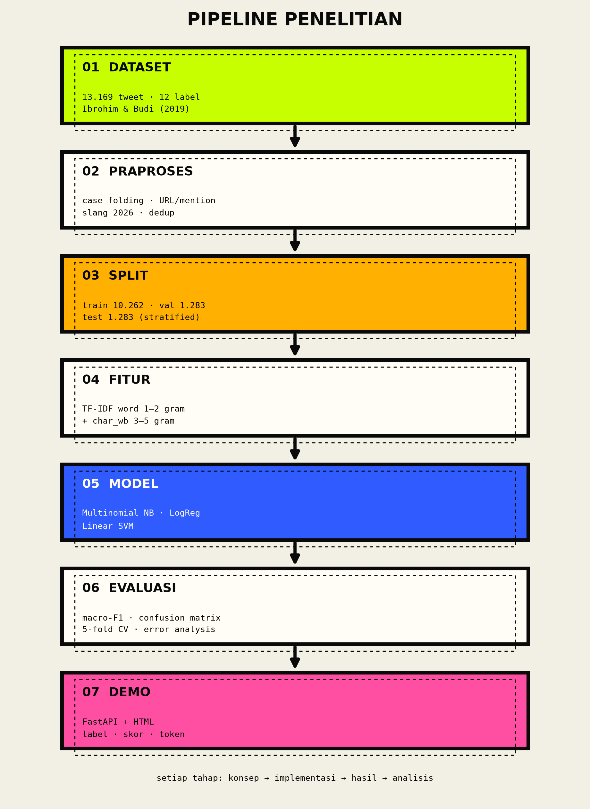
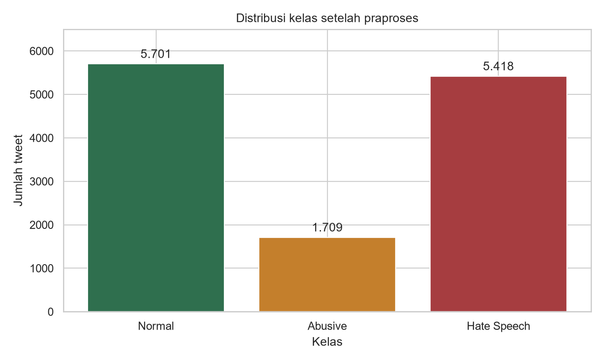
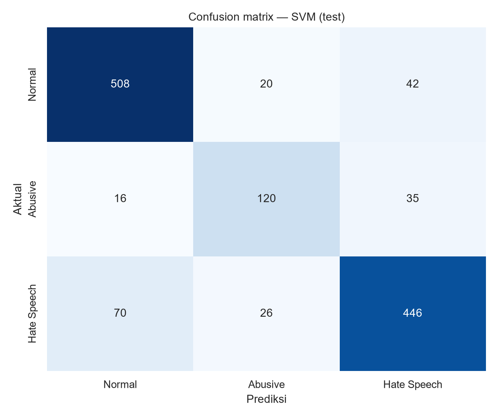
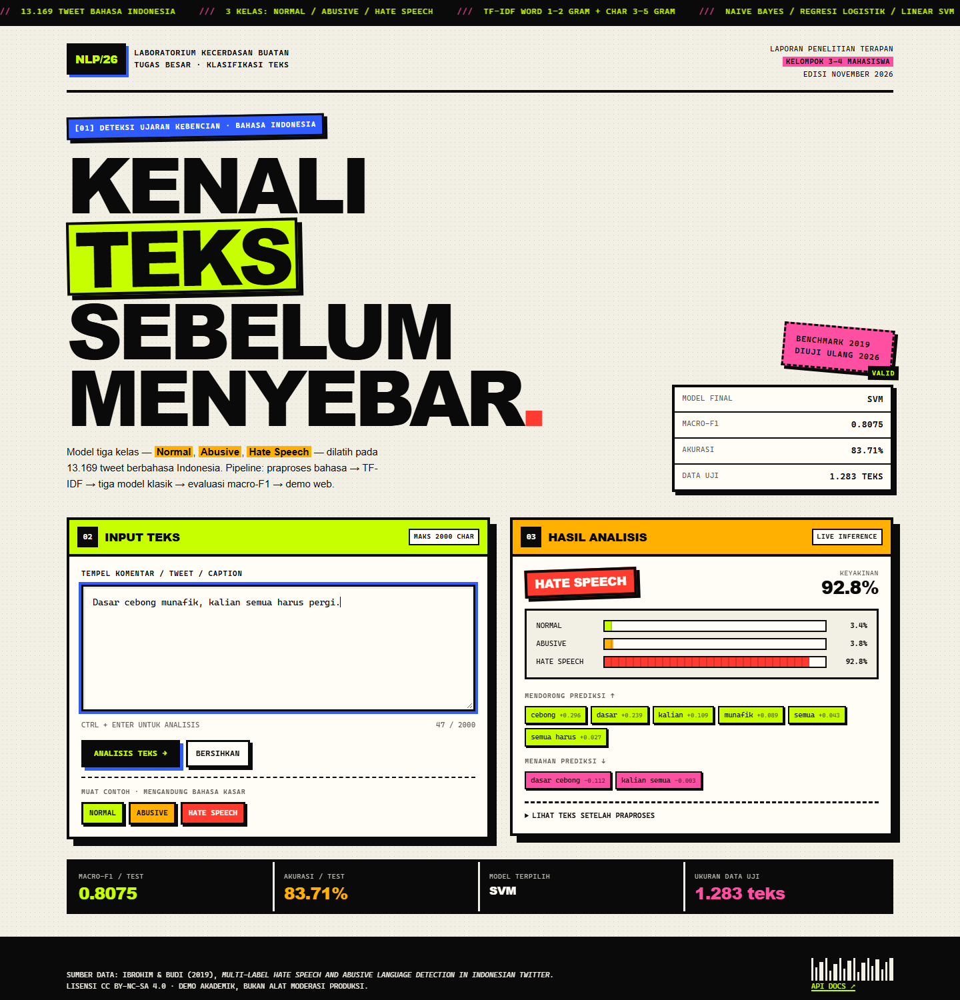

# Deteksi Ujaran Kebencian dan Bahasa Abusif pada Teks Bahasa Indonesia Menggunakan TF-IDF dan Perbandingan Tiga Model Klasik

**Tugas Besar Kecerdasan Buatan 2026**

| | |
|---|---|
| Kelompok | [isi nomor kelompok] |
| Anggota 1 | [Nama] / [NIM] |
| Anggota 2 | [Nama] / [NIM] |
| Anggota 3 | [Nama] / [NIM] |
| Anggota 4 | [Nama] / [NIM] |
| Program Studi | D4 Rekayasa Perangkat Lunak |
| Jurusan | Teknik Informatika, Politeknik Negeri Indramayu |
| Tanggal | November 2026 |

---

## Abstrak

Ujaran kebencian dan bahasa abusif di media sosial menimbulkan dampak sosial yang nyata, tetapi moderasi manual tidak lagi mampu mengikuti volume percakapan. Penelitian ini membangun pipeline klasifikasi teks bahasa Indonesia tiga kelas — Normal, Abusive, dan Hate Speech — dengan memanfaatkan 13.169 tweet dari dataset Ibrohim dan Budi (2019). Setelah deduplikasi, 12.828 teks diproses melalui pembersihan karakter, normalisasi slang dengan kamus 15.151 entri, dan pembaruan istilah 2026. Representasi teks menggunakan TF-IDF gabungan word 1–2 gram dan char_wb 3–5 gram, kemudian dibandingkan tiga model: Multinomial Naive Bayes, Regresi Logistik, dan Linear SVM. Pemilihan hyperparameter dilakukan pada validation set, sedangkan test set hanya digunakan sekali untuk evaluasi akhir. Linear SVM dengan C = 0,1 memberikan hasil terbaik dengan akurasi 83,71% dan macro-F1 0,8075; Regresi Logistik mencapai macro-F1 0,7859 dan Naive Bayes 0,7601. Kelas Abusive menjadi kelas tersulit dengan F1 0,7122 karena batasnya sering tumpang tindih dengan Hate Speech dan Normal. Hasil ini menunjukkan bahwa pipeline klasik yang sederhana, dengan praproses yang tepat dan evaluasi yang jujur, sudah mampu menjadi baseline yang kuat sebelum model transformer yang lebih mahal.

**Kata kunci:** ujaran kebencian, bahasa Indonesia, TF-IDF, Naive Bayes, SVM, klasifikasi teks

---

## 1. Pendahuluan

### 1.1 Latar belakang

Percakapan publik di media sosial tumbuh jauh lebih cepat daripada kemampuan manusia memoderasinya. Sebuah unggahan dapat menerima ribuan komentar dalam hitungan jam, sementara tim moderasi biasanya hanya terdiri dari beberapa orang. Akibatnya, ujaran kebencian dan bahasa abusif sering lolos, menyebar, lalu memicu konflik lanjutan. Di Indonesia, persoalan ini juga bersinggungan dengan kerangka hukum, khususnya pasal-pasal pencemaran nama baik dan ujaran kebencian di UU ITE, sehingga keputusan moderasi tidak bisa sepenuhnya diserahkan kepada model otomatis. Diperlukan sistem yang mampu menyaring secara cepat, tetapi tetap menyediakan ruang bagi manusia untuk meninjau keputusan akhir.

Pendekatan berbasis aturan dan daftar kata terlarang cepat usang. Kata kasar dapat disamarkan dengan angka, singkatan, atau variasi ejaan; sebaliknya, kata yang tampak kasar belum tentu merupakan ujaran kebencian karena sangat bergantung pada konteks. Pendekatan pembelajaran mesin menawarkan jalan tengah: model belajar pola dari data berlabel, bukan dari daftar kata yang ditulis manual. Untuk bahasa Indonesia, salah satu benchmark yang paling banyak dipakai adalah dataset multi-label dari Ibrohim dan Budi (2019) yang berisi 13.169 tweet dengan anotasi hate speech dan bahasa abusif.

Penelitian ini tidak hanya melatih satu model, tetapi membandingkan tiga model klasik yang mewakili tiga cara berpikir berbeda: Naive Bayes yang probabilistik, Regresi Logistik yang mengoptimalkan likelihood, dan Support Vector Machine yang memaksimalkan margin. Perbandingan ini penting karena pada data teks berdimensi tinggi dan relatif kecil, model linier sering kali kompetitif terhadap model yang jauh lebih kompleks. Dengan memahami mengapa sebuah model menang, kita dapat menjelaskan keterkaitan antara teori yang dipelajari di kelas dan keputusan implementasi yang diambil.

### 1.2 Rumusan masalah

1. Bagaimana membangun pipeline praproses yang sesuai untuk teks media sosial bahasa Indonesia yang mengandung slang, typo, dan kata berulang?
2. Seberapa baik TF-IDF dengan word dan char n-gram merepresentasikan teks untuk tugas klasifikasi tiga kelas?
3. Model mana di antara Multinomial Naive Bayes, Regresi Logistik, dan Linear SVM yang memberikan performa terbaik pada data uji, dan mengapa?
4. Kesalahan seperti apa yang masih dilakukan model, terutama pada kelas Abusive yang jumlahnya lebih sedikit?

### 1.3 Tujuan

1. Mengimplementasikan pipeline klasifikasi teks end-to-end, dari akuisisi data sampai demo web.
2. Membandingkan performa tiga model klasik dengan protokol evaluasi yang terkontrol.
3. Menganalisis sumber kesalahan model dan keterbatasan dataset.
4. Menyediakan baseline yang dapat dikembangkan menjadi sistem moderasi berbantuan manusia.

### 1.4 Manfaat

Bagi peneliti, penelitian ini menyediakan baseline dan analisis kesalahan yang dapat dibandingkan dengan model transformer. Bagi praktisi, pipeline ini menunjukkan bahwa model linier dengan TF-IDF masih layak dijadikan penyaring awal karena murah, cepat, dan mudah dijelaskan. Bagi pembelajaran, proyek ini mendemonstrasikan bagaimana teori representasi teks, probabilistik, optimasi margin, dan evaluasi bertemu dalam satu artefak yang dapat dijalankan.

### 1.5 Batasan

Penelitian ini dibatasi pada teks berbahasa Indonesia, tiga kelas, dan data dari Twitter 2018–2019. Model tidak dirancang untuk video, audio, atau percakapan multi-turn. Keputusan model tidak dimaksudkan sebagai putusan final, melainkan sebagai sinyal awal yang harus ditinjau manusia.

---

## 2. Landasan Teori

### 2.1 Klasifikasi teks sebagai pembelajaran terawasi

Klasifikasi teks adalah tugas memberi label pada urutan token berdasarkan pola yang dipelajari dari contoh berlabel. Secara formal, diberikan himpunan data latih \(D = \{(x_i, y_i)\}_{i=1}^{N}\) dengan \(x_i\) adalah teks dan \(y_i \in \{\text{Normal}, \text{Abusive}, \text{Hate Speech}\}\). Tujuannya adalah mempelajari fungsi \(f: \mathcal{X} \rightarrow \mathcal{Y}\) yang meminimalkan kesalahan pada data yang belum pernah dilihat. Karena teks tidak dapat langsung diolah sebagai bilangan, setiap dokumen harus dipetakan terlebih dahulu menjadi vektor fitur. Kualitas pemetaan ini sering kali lebih menentukan daripada kompleksitas model.

### 2.2 Praproses teks bahasa Indonesia

Teks media sosial tidak mengikuti kaidah ejaan baku. Kata dapat disingkat (*yg*, *gak*, *bgt*), dipanjangkan (*bagusss*), atau dicampur dengan bahasa Inggris. Praproses bertujuan mengurangi variasi yang tidak informatif tanpa menghapus sinyal yang membedakan kelas. Pada penelitian ini, praproses mencakup case folding, penghapusan URL dan mention, penggantian karakter berulang, penghapusan non-alfabet, normalisasi slang, dan deduplikasi.

Satu keputusan penting adalah tidak menghapus stopword dan tidak menormalisasi kata abusif. Kata seperti *tidak*, *bukan*, dan *jangan* mengubah makna secara drastis; menghapusnya dapat membalik label. Kata abusif juga sengaja dipertahankan karena justru merupakan fitur pembeda antara kelas Normal dan Abusive.

### 2.3 Representasi TF-IDF

TF-IDF (*Term Frequency–Inverse Document Frequency*) memberi bobot pada kata berdasarkan seberapa sering kata muncul dalam dokumen dan seberapa langka kata itu di seluruh korpus. Bobot TF-IDF untuk term \(t\) pada dokumen \(d\) dirumuskan sebagai:

\[
\text{tf-idf}(t,d) = \text{tf}(t,d) \times \text{idf}(t)
\]

\[
\text{idf}(t) = \log\frac{1+N}{1+\text{df}(t)} + 1
\]

dengan \(N\) jumlah dokumen dan \(\text{df}(t)\) jumlah dokumen yang mengandung term \(t\). Kata yang muncul di hampir semua dokumen memiliki IDF rendah, sedangkan kata yang khas pada sedikit dokumen memiliki IDF tinggi. Pada implementasi ini, TF-IDF dihitung untuk dua jenis fitur: **word n-gram 1–2** yang menangkap frasa pendek, dan **char_wb n-gram 3–5** yang menangkap pola karakter dan awalan/akhiran. Char n-gram sangat membantu ketika ejaan tidak baku, misalnya *goblok*, *goblokk*, dan *goblokkk* memiliki irisan karakter yang besar.

### 2.4 Multinomial Naive Bayes

Naive Bayes mengasumsikan bahwa setiap fitur (kata) muncul secara independen dengan kelasnya. Meskipun asumsi ini jelas tidak benar dalam bahasa, model ini sering memberikan hasil yang kuat pada klasifikasi teks karena dimensinya tinggi dan datanya relatif kecil. Untuk kelas \(c\) dan dokumen \(d\) yang terdiri atas token \(t_1, \dots, t_m\):

\[
P(c \mid d) \propto P(c) \prod_{j=1}^{m} P(t_j \mid c)
\]

Probabilitas \(P(t_j \mid c)\) diestimasi dengan penghalusan Laplace (parameter \(\alpha\)) untuk menghindari probabilitas nol. Kelebihan model ini adalah latihannya sangat cepat dan mudah diinterpretasi; kelemahannya adalah asumsi independensi dan kecenderungannya kalah ketika fitur saling berkorelasi kuat.

### 2.5 Regresi Logistik

Regresi Logistik memodelkan probabilitas kelas sebagai fungsi linear dari fitur, lalu melewatkannya melalui softmax untuk masalah multikelas:

\[
P(y=c \mid x) = \frac{\exp(w_c^\top x + b_c)}{\sum_{k} \exp(w_k^\top x + b_k)}
\]

Parameter \(W\) dan \(b\) dioptimalkan dengan memaksimalkan likelihood (setara meminimalkan cross-entropy). Berbeda dari Naive Bayes, model ini tidak mengasumsikan independensi fitur, sehingga dapat menangkap korelasi antar-kata. Bobot \(w_c\) juga dapat dibaca sebagai kontribusi fitur terhadap kelas \(c\), yang membuat model ini berguna untuk analisis.

### 2.6 Support Vector Machine

SVM mencari hyperplane yang memisahkan kelas dengan margin terbesar. Untuk data yang tidak sepenuhnya terpisah, digunakan *soft margin* dengan variabel slack \(\xi_i\):

\[
\min_{w,b,\xi} \frac{1}{2}\|w\|^2 + C \sum_{i=1}^{N} \xi_i
\]

\[
\text{dengan } y_i(w^\top x_i + b) \ge 1 - \xi_i, \quad \xi_i \ge 0
\]

Parameter \(C\) mengontrol trade-off antara margin lebar dan toleransi kesalahan. Pada teks berdimensi tinggi, SVM linier sering sangat efektif karena data cenderung dapat dipisahkan secara linear di ruang fitur yang jarang. Selain itu, hanya sebagian kecil data yang menjadi *support vector*, sehingga prediksi relatif cepat.

### 2.7 Evaluasi model

Akurasi saja tidak cukup ketika kelas tidak seimbang. Pada data ini, kelas Abusive hanya 13,32% dari total, sehingga model yang selalu memprediksi Normal bisa terlihat memiliki akurasi tinggi tetapi tidak berguna. Oleh karena itu, metrik utama yang digunakan adalah **macro-F1**, yaitu rata-rata F1 setiap kelas tanpa mempertimbangkan jumlah sampel:

| Metrik | Rumus |
|---|---|
| Precision | \(P = TP / (TP + FP)\) |
| Recall | \(R = TP / (TP + FN)\) |
| F1 | \(F_1 = 2PR / (P + R)\) |

\[
\text{macro-F1} = \frac{1}{K}\sum_{k=1}^{K} F1_k
\]

Confusion matrix digunakan untuk melihat pola kesalahan antar-kelas, sedangkan validasi silang 5-fold pada data latih digunakan untuk mengukur stabilitas model.

### 2.8 Keterkaitan teori dan implementasi

| Teori | Implementasi | Bukti |
|---|---|---|
| Vector Space Model dan TF-IDF | `TfidfVectorizer` word + char_wb | `src/train.py` bagian `make_vectorizer` |
| Teorema Bayes dan penghalusan Laplace | `MultinomialNB(alpha=...)` | Model NB, tuning \(\alpha\) |
| Regresi multinomial dan cross-entropy | `LogisticRegression` | Model LR, `predict_proba` |
| Margin maksimum dan hinge loss | `LinearSVC(C=...)` | Model SVM, tuning \(C\) |
| Evaluasi klasifikasi | `classification_report`, `confusion_matrix` | `results/classification_report.txt` |
| Validasi model | `StratifiedKFold`, split 80/10/10 | `results/metrics.json` |
| Explainability | koefisien model × nilai TF-IDF | `src/inference.py`, `results/top_features.csv` |

---

## 3. Metodologi dan Implementasi

### 3.1 Desain pipeline

Pipeline penelitian ini terdiri atas tujuh tahap yang dapat direproduksi:



*Gambar 1. Diagram pipeline penelitian, dari dataset mentah sampai demo web.*

Setiap tahap dijelaskan dengan empat komponen yang diminta: konsep, implementasi, hasil, dan analisis.

### 3.2 Akuisisi data

**Konsep.** Dataset publik dipilih agar penelitian dapat direproduksi dan hasilnya dapat dibandingkan dengan penelitian lain. Dataset harus memiliki label yang relevan, teks asli, dan lisensi yang jelas.

**Implementasi.** Data diunduh dari repositori GitHub resmi Ibrohim dan Budi (2019) melalui `src/download_data.py`. Tiga berkas yang dipakai adalah `re_dataset.csv` (teks dan label), `new_kamusalay.csv` (kamus slang), dan `abusive.csv` (leksikon kata abusif). Tidak diperlukan autentikasi API.

**Hasil.** Dataset mentah berisi 13.169 baris dan 13 kolom: satu kolom teks dan 12 kolom label. Sebanyak 5.561 tweet berlabel `HS=1`, 5.043 berlabel `Abusive=1`, dan 5.860 tidak memiliki kedua label tersebut. Setelah deduplikasi teks, tersisa 12.828 baris unik (341 duplikat dibuang).

**Analisis.** Jumlah data cukup untuk melatih model linier dan melakukan validasi silang, tetapi tidak cukup besar untuk melatih transformer dari nol. Karena itu, pendekatan yang realistis adalah model klasik dengan fitur TF-IDF, atau transformer pra-terlatih yang di-*fine-tune* bila sumber daya tersedia. Deduplikasi penting dilakukan sebelum split agar teks yang sama tidak muncul di train dan test sekaligus, yang akan membuat skor evaluasi terlalu optimistis.

### 3.3 Pemetaan label

**Konsep.** Dataset asli bersifat multilabel: satu tweet dapat sekaligus mengandung ujaran kebencian dan bahasa abusif. Untuk tugas ini, label dipetakan menjadi tiga kelas yang saling eksklusif agar evaluasi lebih sederhana dan interpretatif.

**Implementasi.** Aturan pemetaan pada `src/preprocess.py`:

```python
def map_label(row):
    if int(row["HS"]) == 1:
        return "Hate Speech"
    if int(row["Abusive"]) == 1:
        return "Abusive"
    return "Normal"
```

**Hasil.** Distribusi akhir: Normal 5.701 (44,44%), Abusive 1.709 (13,32%), Hate Speech 5.418 (42,24%).

**Analisis.** Pemetaan ini mengorbankan informasi target ujaran (agama, ras, gender) dan tingkat keparahan, tetapi menghasilkan kelas yang lebih seimbang dan cukup data per kelas. Kelas Abusive tetapMinoritas, sehingga `class_weight="balanced"` diterapkan pada Regresi Logistik dan SVM. Naive Bayes tidak memiliki parameter tersebut; ini salah satu keterbatasannya pada data tidak seimbang.

### 3.4 Praproses

**Konsep.** Praproses harus mengurangi noise tanpa menghapus sinyal. Untuk teks media sosial, noise utama adalah URL, mention, *retweet* marker, karakter berulang, dan ejaan slang.

**Implementasi.** Fungsi `basic_clean`, `normalize_slang`, dan `preprocess_dataframe` pada `src/preprocess.py` melakukan:

1. Case folding dan penghapusan token `USER`/`URL`.
2. Penghapusan URL, mention, dan penanda `RT`.
3. Pengubahan hashtag menjadi kata biasa.
4. Penggantian karakter berulang tiga kali atau lebih (`goblokkk` → `goblok`).
5. Penghapusan karakter non-alfabet.
6. Normalisasi slang memakai 15.151 entri, termasuk pembaruan 2026 seperti *rizz* → *pesona*, *flexing* → *pamer*, *mager* → *malas gerak*.
7. Deduplikasi teks dan pembuangan teks yang terlalu pendek.

Kata abusif sengaja dikecualikan dari normalisasi. Stopword juga tidak dihapus.

**Hasil.** Panjang teks setelah praproses: median 16 kata (rata-rata 18,09; maksimum 143), median 96 karakter. Kosakata unik 19.155 kata. Contoh teks bersih:

- Normal: “kadang aku berpikir kenapa aku tetap percaya pada tuhan...”
- Abusive: “siapa yang telat memberi tahu kamu edan sarap gue bergaul...”
- Hate Speech: “di saat semua cowok berusaha melacak perhatian gue kamu lantas remehkan...”

**Analisis.** Char n-gram membuat pipeline tidak terlalu bergantung pada stemming. Stemming Sastrawi sempat diuji, tetapi biayanya sangat tinggi untuk 13 ribu tweet (lebih dari 20 menit pada mesin uji) dan tidak sepadan untuk baseline. Dengan char_wb 3–5 gram, variasi morfologi seperti *bermain*, *main*, *memainkan* tetap memiliki irisan karakter yang cukup. Keputusan ini didokumentasikan sebagai batasan, bukan disembunyikan.

### 3.5 Pembagian data dan tuning

**Konsep.** Data dibagi menjadi train, validation, dan test. Validation dipakai untuk memilih hyperparameter; test hanya dipakai sekali agar estimasi performa tidak bias.

**Implementasi.** `train_test_split` dengan `stratify=y` dan `random_state=42` menghasilkan train 10.262, validation 1.283, dan test 1.283. Tuning dilakukan pada validation untuk:

- NB: \(\alpha \in \{0,1; 0,5; 1,0\}\)
- LR: \(C \in \{0,5; 1,0; 5,0\}\)
- SVM: \(C \in \{0,1; 0,5; 1,0; 2,0\}\)

Setelah konfigurasi terbaik ditemukan, model dilatih ulang pada train + validation dan dievaluasi pada test. Validasi silang 5-fold pada train dijalankan untuk model terpilih guna melihat stabilitas.

**Hasil.** Konfigurasi terbaik di validation: NB \(\alpha=0,1\) (macro-F1 0,7698), LR \(C=1,0\) (0,8023), SVM \(C=0,1\) (0,8056). Validasi silang 5-fold SVM memberikan macro-F1 0,7862 ± 0,0078.

**Analisis.** Selisih validation dan test yang kecil (0,8056 vs 0,8075) menunjukkan model tidak terlalu overfit. Ritme ini penting: jika test jauh lebih rendah dari validation, kemungkinan ada kebocoran data atau split yang tidak representatif. Karena test hanya dipakai sekali, angka 0,8075 dapat dipercaya sebagai estimasi performa pada distribusi data yang sama.

### 3.6 Ekstraksi fitur

**Konsep.** TF-IDF mengubah teks menjadi vektor jarang (*sparse*) yang menimbang kata berdasarkan kepentingannya. Word n-gram menangkap frasa seperti *tidak pantas*; char n-gram menangkap pola ejaan yang tidak baku.

**Implementasi.** `FeatureUnion` menggabungkan dua vectorizer:

```python
word = TfidfVectorizer(
    analyzer="word", ngram_range=(1, 2), min_df=3,
    max_df=0.95, max_features=50_000, sublinear_tf=True,
)
char = TfidfVectorizer(
    analyzer="char_wb", ngram_range=(3, 5), min_df=3,
    max_features=50_000, sublinear_tf=True,
)
features = FeatureUnion([("word", word), ("char", char)])
```

`min_df=3` membuang kata yang sangat langka agar tidak menjadi noise. `max_df=0.95` membuang kata yang muncul di hampir semua dokumen. `sublinear_tf=True` meredam pengaruh kata yang muncul sangat sering.

**Hasil.** Word vectorizer menghasilkan 15.315 fitur; char vectorizer 50.000 fitur. Total 65.315 fitur per dokumen, sebagian besar bernilai nol (sparse).

**Analisis.** Dimensi yang sangat tinggi bukan masalah untuk model linier karena kompleksitasnya bergantung pada jumlah fitur non-nol, bukan dimensi total. Namun, dimensi tinggi membuat model lebih sulit diinterpretasi; karena itu analisis fitur pada laporan ini dibatasi pada fitur kata, bukan char n-gram.

### 3.7 Pemodelan

**Konsep.** Tiga model dipilih untuk mewakili tiga pendekatan: probabilistik (NB), diskriminatif linear dengan likelihood (LR), dan margin maksimum (SVM).

**Implementasi.** Ketiga model dilatih dengan pipeline yang sama. LR dan SVM menggunakan `class_weight="balanced"`; NB menggunakan penghalusan \(\alpha\). Untuk demo, model terpilih adalah SVM; skor kelas dihitung dengan softmax dari `decision_function` karena SVM tidak menghasilkan probabilitas terkalibrasi.

**Hasil.** Pada test set, SVM mencapai akurasi 83,71% dan macro-F1 0,8075; LR 82,00% dan 0,7859; NB 79,89% dan 0,7601.

**Analisis.** SVM unggul karena data teks berdimensi tinggi cenderung dapat dipisahkan secara linear, dan margin maksimum memberikan regularisasi alami. LR lebih mudah diprobabilistikkan dan diinterpretasi, tetapi sedikit kalah. NB paling cepat, tetapi asumsi independensinya tidak terpenuhi dan tidak memiliki mekanisme class weight, sehingga recall kelas Abusive lebih rendah.

### 3.8 Evaluasi

**Konsep.** Evaluasi menggunakan accuracy, macro-F1, weighted-F1, precision/recall per kelas, dan confusion matrix. Macro-F1 menjadi metrik utama karena memberi bobot yang sama pada setiap kelas.

**Implementasi.** `sklearn.metrics.classification_report` dan `confusion_matrix` dijalankan pada test set. Hasil disimpan ke `results/classification_report.txt`, `results/confusion_matrix.png`, dan `results/metrics.json`. Error analysis mengekspor seluruh prediksi ke `results/test_predictions.csv` dan kesalahan dengan keyakinan tertinggi ke `results/error_analysis.csv`.

**Hasil.** Ringkasan per kelas untuk SVM:

| Kelas | Precision | Recall | F1 | Support |
|---|---:|---:|---:|---:|
| Normal | 0,8552 | 0,8912 | 0,8729 | 570 |
| Abusive | 0,7229 | 0,7018 | 0,7122 | 171 |
| Hate Speech | 0,8528 | 0,8229 | 0,8376 | 542 |
| **Macro avg** | **0,8103** | **0,8053** | **0,8075** | **1.283** |
| **Accuracy** | | | **0,8371** | **1.283** |

**Analisis.** Kelas Normal paling mudah dikenali karena kosakatanya lebih beragam dan tidak menyerang. Kelas Abusive paling sulit karena sering berbagi kata dengan Hate Speech, tetapi tanpa target kelompok yang jelas. Recall Abusive 0,7018 berarti sekitar 30% teks Abusive lolos atau salah diklasifikasi. Untuk aplikasi moderasi, jenis kesalahan ini perlu diperhatikan karena dapat meloloskan konten yang merendahkan.

### 3.9 Demo web

**Konsep.** Model harus dapat didemonstrasikan, bukan hanya berupa angka di notebook. Demo web memungkinkan penguji memasukkan teks baru dan melihat keputusan model secara langsung.

**Implementasi.** `app/main.py` menyediakan endpoint `POST /api/predict` yang memuat model `.joblib`, melakukan praproses yang sama dengan training, lalu mengembalikan label, confidence, probabilitas tiga kelas, dan token yang paling memengaruhi prediksi. `public/index.html` menampilkan antarmuka brutalist dengan input teks, contoh, bar probabilitas, dan chip kata.

**Hasil.** Demo berjalan lokal di `http://localhost:8000` dan dapat dideploy ke Vercel. Endpoint `GET /api/model-info` menampilkan macro-F1 dan akurasi dari `results/metrics.json`; `GET /docs` menyediakan dokumentasi API otomatis.

**Analisis.** Explainability dihitung dari koefisien model dikalikan nilai TF-IDF kata pada dokumen. Untuk SVM multikelas, koefisien kelas prediksi menunjukkan arah kontribusi; nilai positif mendorong prediksi, nilai negatif menahannya. Ini bukan kausalitas, melainkan pintasan interpretasi yang berguna untuk memahami perilaku model.

---

## 4. Hasil dan Pembahasan

### 4.1 Analisis data eksploratif

Distribusi kelas setelah praproses ditunjukkan pada Gambar 2. Kelas Normal dan Hate Speech hampir seimbang (44,44% dan 42,24%), sedangkan Abusive hanya 13,32%. Ketidakseimbangan ini menjelaskan mengapa macro-F1 lebih rendah dari accuracy: model cenderung lebih baik pada dua kelas mayoritas.



*Gambar 2. Distribusi kelas setelah praproses dan deduplikasi.*

Gambar 3 menunjukkan bahwa panjang tweet antar-kelas tidak berbeda drastis, dengan median 16 kata. Ini berarti panjang teks bukan fitur pembeda yang kuat, dan model memang harus belajar dari pilihan kata.


*Gambar 3. Distribusi panjang tweet per kelas (jumlah kata).*

Gambar 4 memperlihatkan kata yang sering muncul per kelas. Kelas Hate Speech didominasi kata yang menunjuk kelompok dan sifat merendahkan; kelas Abusive lebih banyak kata kasar yang tidak selalu terarah ke kelompok; kelas Normal lebih beragam dan didominasi kata sehari-hari. Pola ini mendukung penggunaan TF-IDF: kata-kata tersebut memang memiliki IDF tinggi dan menjadi sinyal yang berguna.


*Gambar 4. Kata paling sering per kelas setelah stopword umum dibuang (untuk EDA).*

### 4.2 Perbandingan model

| Model | Konfigurasi | Val macro-F1 | Test accuracy | Test macro-F1 | Test weighted-F1 |
|---|---|---:|---:|---:|---:|
| Multinomial NB | \(\alpha=0,1\) | 0,7698 | 79,89% | 0,7601 | 0,8018 |
| Regresi Logistik | \(C=1,0\) | 0,8023 | 82,00% | 0,7859 | 0,8216 |
| Linear SVM | \(C=0,1\) | 0,8056 | 83,71% | **0,8075** | **0,8365** |

SVM unggul sekitar 2,2 poin macro-F1 di atas LR dan 4,7 poin di atas NB. Selisih ini konsisten dengan temuan umum pada klasifikasi teks: model linier dengan regularisasi yang tepat sering kompetitif, terutama ketika jumlah data tidak mencapai jutaan contoh.

### 4.3 Confusion matrix dan pola kesalahan

Confusion matrix model SVM tersedia di `results/confusion_matrix.png`. Dari 1.283 teks uji, 1.074 diprediksi benar dan 209 salah. Sebaran lengkapnya:

| Aktual \ Prediksi | Normal | Abusive | Hate Speech | Total |
|---|---:|---:|---:|---:|
| **Normal** | **508** | 20 | 42 | 570 |
| **Abusive** | 16 | **120** | 35 | 171 |
| **Hate Speech** | 70 | 26 | **446** | 542 |
| **Total** | 594 | 166 | 523 | 1.283 |

Pola utamanya:

- **Hate Speech → Normal** adalah kesalahan terbanyak (70 teks, 12,9% dari kelas Hate Speech). Banyak teks hate speech tidak memakai kata kasar eksplisit, sehingga model kehilangan sinyal leksikal yang biasa ia andalkan.
- **Normal → Hate Speech** (42 teks, 7,4%) biasanya terjadi pada teks yang membahas kelompok atau politik dengan kata yang mirip dengan data hate speech.
- **Abusive → Hate Speech** (35 teks, 20,5% dari kelas Abusive) menunjukkan batas yang paling kabur: keduanya berbagi kata kasar, dan model kadang terlalu agresif menyimpulkan adanya target kelompok.
- **Abusive → Normal** (16 teks) dan **Normal → Abusive** (20 teks) lebih sedikit, tetapi tetap menunjukkan bahwa kata kasar saja tidak cukup untuk menentukan kelas.

Secara agregat, kebingungan terbesar adalah **Hate Speech ↔ Normal** (112 teks), disusul **Abusive ↔ Hate Speech** (61 teks), lalu **Normal ↔ Abusive** (36 teks). Ini konsisten dengan sifat data: kelas Abusive berada di antara dua kutub, sedangkan Hate Speech dan Normal sama-sama bisa membahas topik yang sama dengan cara yang berbeda.



*Gambar 5. Confusion matrix model Linear SVM pada 1.283 teks uji.*

**Ambang indikasi.** Demo web memakai aturan *argmax*, yaitu kelas dengan skor tertinggi, sehingga tidak ada ambang persen tetap. Jika ingin satu ambang untuk keputusan biner “indikasi hate”, hasil sapuan ambang pada test set adalah:

| Aturan | Precision | Recall | F1 | Hate terdeteksi |
|---|---:|---:|---:|---:|
| Argmax (demo) | 0,8528 | 0,8229 | 0,8376 | 446/542 |
| Skor hate ≥ 0,35 | 0,8033 | 0,8893 | **0,8441** | 482/542 |
| Skor hate ≥ 0,50 | 0,9002 | 0,6827 | 0,7765 | 370/542 |

Ambang 0,35 memberi recall tertinggi (88,9%) dengan konsekuensi lebih banyak false positive; ambang 0,50 lebih konservatif (precision 90,0%) tetapi melewatkan sekitar 31,7% hate speech. Untuk penyaringan awal yang menekankan jangan sampai lolos, ambang 0,35 lebih masuk akal; untuk keputusan yang lebih hati-hati, gunakan 0,50. Perlu ditegaskan bahwa skor SVM bukan probabilitas terkalibrasi, sehingga “0,35” bukan berarti “35% peluang hate”; ambang ini relatif terhadap dataset 2019 dan perlu dikalibrasi ulang pada data validasi atau data baru.

Angka per kelas menunjukkan bahwa model lebih konservatif pada Abusive: precision 0,7229 dan recall 0,7018. Artinya, ketika model memprediksi Abusive, sekitar 28% di antaranya sebenarnya kelas lain; dan sekitar 30% teks Abusive tidak terdeteksi. Untuk penggunaan nyata, ambang keputusan dapat disesuaikan: menurunkan ambang Abusive akan meningkatkan recall tetapi menurunkan precision.

### 4.4 Analisis kesalahan kualitatif

Tabel berikut merangkum jenis kesalahan yang paling sering muncul. Contoh teks disensor dan tidak ditampilkan lengkap untuk alasan etika.

| Jenis kesalahan | Pola | Mengapa sulit |
|---|---|---|
| Abusive diprediksi Hate Speech | Kata kasar + kata kelompok | Model melihat kata kelompok sebagai sinyal hate speech meskipun tidak ada serangan |
| Hate Speech diprediksi Normal | Sarkasme, eufemisme | Tidak ada kata kasar; makna dibangun dari konteks |
| Normal diprediksi Abusive | Kutipan atau pelaporan | Kata kasar muncul dalam konteks melaporkan, bukan menyerang |
| Abusive diprediksi Normal | Singkatan/typo baru | Kata tidak ada di kosakata latih atau dinormalisasi berlebihan |

Pola ini menunjukkan batas model *bag-of-words*: model tidak memahami negasi jangka panjang, pelaku, target, dan konteks percakapan. Model transformer yang melihat urutan token dan konteks dua arah berpotensi mengurangi kesalahan jenis ini, tetapi membutuhkan sumber daya dan data yang lebih besar.

### 4.5 Fitur yang paling berpengaruh

`results/top_features.csv` memuat 20 fitur teratas per kelas. Untuk kelas Hate Speech, fitur dengan bobot tertinggi adalah **cebong**, **ganti presiden**, **ahok**, **prabowo**, **bubarkan**, dan **usir**. Untuk kelas Abusive, fitur teratas adalah kata kasar yang tidak terikat kelompok (misalnya *edan*, `anj*r`, `b*d*h`). Untuk kelas Normal, fitur teratas justru mencakup **bom**, **budaya**, **kunti**, **presiden jokowi**, **sipit**, **katolik**, dan **ekonomi**.

Temuan terakhir menarik dan perlu dibaca kritis. Kata-kata seperti *bom*, *sipit*, dan *katolik* bukan kata “normal” secara intrinsik; dalam data 2019, kata-kata itu muncul pada tweet berita, diskusi politik, atau percakapan biasa, sehingga bobotnya positif untuk kelas Normal. Model memakai topik sebagai pintasan, bukan semata-mata menilai apakah teks menyerang. Sebaliknya, *cebong*, *ahok*, dan *prabowo* menjadi penanda Hate Speech karena pada data 2019 ketiganya sangat terikat dengan polarisasi politik. Ini menunjukkan risiko bias politik: model dapat mempelajari afiliasi, bukan ujaran kebencian itu sendiri.

Analisis ini harus dibaca dengan hati-hati. Koefisien tinggi tidak berarti kata tersebut selalu menentukan label; kontribusinya bergantung pada nilai TF-IDF dalam dokumen. Kata yang sangat langka bisa memiliki koefisien besar tetapi jarang muncul. Oleh karena itu, interpretasi dilakukan bersama contoh dokumen, bukan hanya dari daftar fitur.

### 4.6 Demo dan pengalaman pengguna

Demo web menampilkan tiga hal yang tidak terlihat di notebook: label prediksi, distribusi skor tiga kelas, dan kata yang mendorong/menahan prediksi. Fitur terakhir membuat model lebih transparan: pengguna dapat melihat apakah keputusan didasarkan pada kata yang relevan atau pada artefak data. Antarmuka juga menyediakan contoh Normal, Abusive, dan Hate Speech untuk mempercepat demonstrasi di depan kelas.

Satu keterbatasan demo adalah skor SVM bukan probabilitas terkalibrasi. Softmax dari `decision_function` berguna untuk perbandingan relatif, tetapi tidak boleh ditafsirkan sebagai peluang sebenarnya. Jika sistem ini dikembangkan lebih lanjut, kalibrasi Platt atau isotonic regression dapat ditambahkan.



*Gambar 6. Tampilan demo web: label, skor tiga kelas, dan token yang mendorong/menahan prediksi.*

### 4.7 Relevansi dataset dan validitas temporal

Dataset ini berasal dari Twitter 2018–2019. Dalam tujuh tahun, bahasa media sosial berubah: muncul istilah seperti *rizz*, *flexing*, *ansos*, dan *mager*, platform percakapan bergeser ke TikTok dan Instagram, dan target ujaran mencakup isu-isu yang belum banyak muncul pada 2019. Karena itu, hasil 83,71% tidak boleh dibaca sebagai performa pada data 2026.

Untuk menutup celah ini, penelitian ini menambahkan kamus slang 2026 dan menyediakan prosedur uji temporal di `data/temporal/README.md`. Tim dapat mengumpulkan 100–200 komentar terbaru, melabelinya secara independen oleh dua anotator, lalu menjalankan `src/evaluate_temporal.py`. Penurunan performa pada sampel baru adalah temuan yang valid tentang *domain shift*, bukan kegagalan penelitian. Dengan demikian, klaim yang dibuat tetap jujur: model valid pada distribusi data yang mirip dengan data latih, dan belum tentu valid pada distribusi 2026.

### 4.8 Ancaman validitas

1. **Validitas konstruk.** Label asli adalah hasil anotasi manusia yang subjektif. Batas antara Abusive dan Hate Speech tidak selalu tajam, terutama pada sarkasme dan sindiran.
2. **Validitas internal.** TF-IDF di-fit pada data latih, dan tuning dilakukan pada validation. Namun, pemilihan fitur dan parameter praproses masih dipengaruhi oleh eksplorasi data, sehingga ada risiko *researcher degrees of freedom*.
3. **Validitas eksternal.** Data Twitter 2019 tidak mewakili TikTok, Instagram, atau percakapan grup pada 2026. Model juga tidak dilatih pada bahasa daerah atau campuran kode yang lebih kompleks.
4. **Validitas statistik.** Ukuran test 1.283 cukup untuk estimasi kasar, tetapi interval kepercayaan untuk macro-F1 belum dihitung. Untuk klaim yang lebih kuat, bootstrap confidence interval dapat ditambahkan.
5. **Etika.** Model dapat bias terhadap kelompok tertentu karena data historis. Sistem tidak boleh dipakai untuk menghukum individu tanpa tinjauan manusia.

---

## 5. Kesimpulan dan Saran

### 5.1 Kesimpulan

Penelitian ini berhasil membangun pipeline klasifikasi ujaran kebencian bahasa Indonesia dari data mentah sampai demo web. Tiga model klasik dibandingkan dengan protokol evaluasi yang terkontrol. Linear SVM dengan TF-IDF word dan char n-gram memberikan performa terbaik: akurasi 83,71% dan macro-F1 0,8075 pada 1.283 teks uji. Regresi Logistik berada di posisi kedua (macro-F1 0,7859), sedangkan Multinomial Naive Bayes berada di posisi ketiga (0,7601).

Kelas Abusive merupakan kelas tersulit dengan F1 0,7122. Analisis kesalahan menunjukkan bahwa batas antara Abusive dan Hate Speech sering kabur, dan model *bag-of-words* tidak cukup untuk memahami sarkasme, negasi, dan konteks. Char n-gram membantu menangani variasi ejaan, sementara class weight membantu model memperhatikan kelas minoritas.

Dari sisi rekayasa, pipeline ini menunjukkan bahwa model linier yang murah dan cepat masih layak menjadi baseline. Demo web dengan penjelasan token membuat keputusan model lebih mudah dipahami, meskipun skor SVM belum terkalibrasi sebagai probabilitas.

### 5.2 Saran

1. **Bandingkan dengan IndoBERT.** *Fine-tune* IndoBERT atau model transformer Indonesia lainnya untuk melihat seberapa besar peningkatan yang diperoleh dibanding model linier.
2. **Uji temporal 2026.** Kumpulkan 100–200 komentar terbaru dan bandingkan performa untuk mengukur *domain shift* secara empiris.
3. **Tangani kelas Abusive.** Coba *oversampling*, *focal loss*, atau penggabungan kelas Abusive–Hate Speech bila tujuan aplikasi lebih menekankan deteksi bahasa kasar secara umum.
4. **Kalibrasi probabilitas.** Gunakan Platt scaling atau isotonic regression agar skor SVM dapat ditafsirkan sebagai peluang.
5. **Analisis konteks.** Tambahkan fitur negasi, target ujaran, atau model berbasis transformer untuk menangkap hubungan antar-kata.
6. **Evaluasi etis.** Libatkan annotator manusia dari berbagai latar belakang dan uji bias model terhadap kelompok tertentu sebelum digunakan di luar demonstrasi.

---

## Daftar Pustaka

Ibrohim, M. O., & Budi, I. (2019). Multi-label hate speech and abusive language detection in Indonesian Twitter. In *Proceedings of the Third Workshop on Abusive Language Online* (pp. 46–57). Association for Computational Linguistics. https://doi.org/10.18653/v1/W19-3506

Joachims, T. (1998). Text categorization with support vector machines: Learning with many relevant features. In *Machine Learning: ECML-98* (pp. 137–142). Springer. https://doi.org/10.1007/BFb0026683

Jurafsky, D., & Martin, J. H. (2023). *Speech and language processing* (3rd ed. draft). Stanford University. https://web.stanford.edu/~jurafsky/slp3/

Koto, F., Rahimi, A., Lau, J. H., & Baldwin, T. (2020). IndoLEM and IndoBERT: A benchmark dataset and pre-trained language model for Indonesian NLP. In *Proceedings of COLING 2020* (pp. 757–770). https://doi.org/10.18653/v1/2020.coling-main.66

Manning, C. D., Raghavan, P., & Schütze, H. (2008). *Introduction to information retrieval*. Cambridge University Press.

McCallum, A., & Nigam, K. (1998). A comparison of event models for Naive Bayes text classification. In *AAAI-98 Workshop on Learning for Text Categorization* (pp. 41–48). AAAI Press.

Pedregosa, F., Varoquaux, G., Gramfort, A., Michel, V., Thirion, B., Grisel, O., Blondel, M., Prettenhofer, P., Weiss, R., Dubourg, V., Vanderplas, J., Passos, A., Cournapeau, D., Brucher, M., Perrot, M., & Duchesnay, É. (2011). Scikit-learn: Machine learning in Python. *Journal of Machine Learning Research, 12*, 2825–2830.

Sastrawi. (n.d.). *Sastrawi: Indonesian stemmer library* [Perangkat lunak]. GitHub. https://github.com/sastrawi/sastrawi

---

## Lampiran A — Struktur Repositori

```text
tugas-besar-nlp/
├─ app/main.py, public/index.html
├─ data/raw/, data/processed/, data/temporal/
├─ models/best_model.joblib, models/preprocess_config.json
├─ results/ (metrik, confusion matrix, error analysis, top features)
├─ src/download_data.py, preprocess.py, train.py, inference.py, evaluate_temporal.py
├─ reports/laporan.md, reports/slides.md
├─ requirements.txt
└─ README.md
```

## Lampiran B — Cara Menjalankan

```bash
python -m pip install -r requirements.txt
python src/download_data.py
python src/preprocess.py
python src/train.py
uvicorn app.main:app --reload --port 8000
```

Buka `http://localhost:8000` untuk demo dan `http://localhost:8000/docs` untuk dokumentasi API.

## Lampiran C — Pernyataan Etika

Data yang digunakan telah dianonimkan oleh pembuat dataset (nama pengguna dan URL diganti menjadi `USER` dan `URL`). Penelitian ini tidak melakukan reidentifikasi. Contoh teks yang mengandung kata kasar disensor dalam laporan. Model tidak boleh digunakan untuk menghukum individu, melakukan doxing, atau mengambil keputusan moderasi tanpa tinjauan manusia. Tujuan penelitian adalah akademik dan demonstrasi metode, bukan pengembangan sistem pengawasan.
