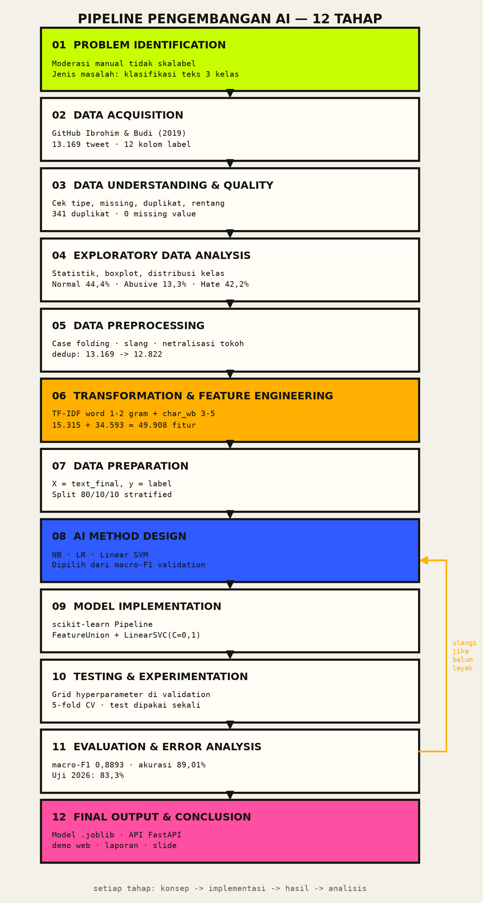
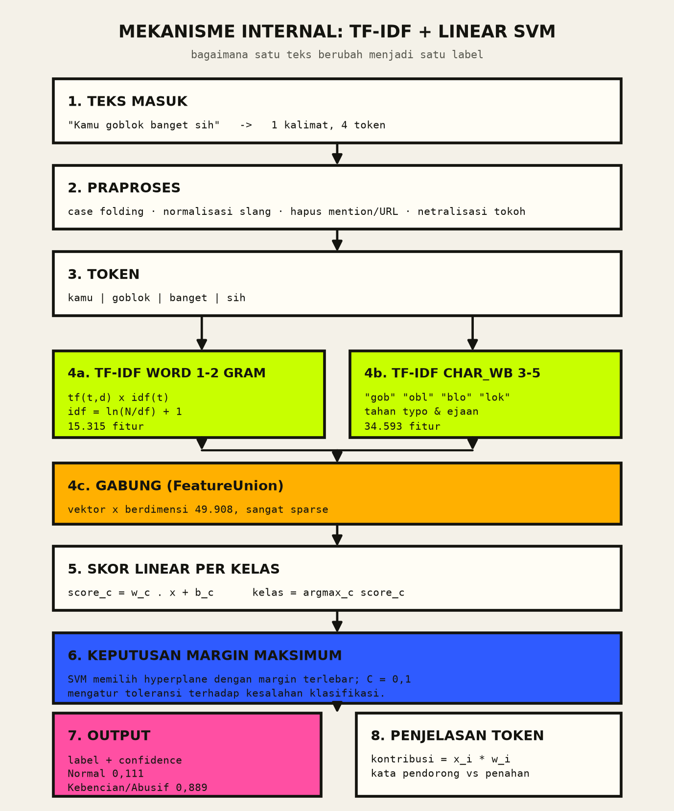
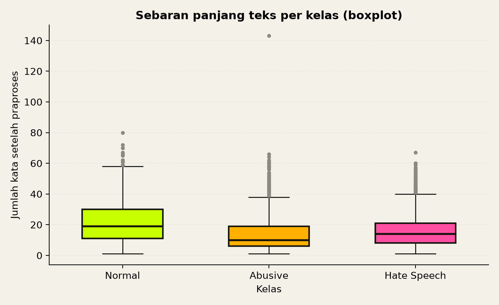
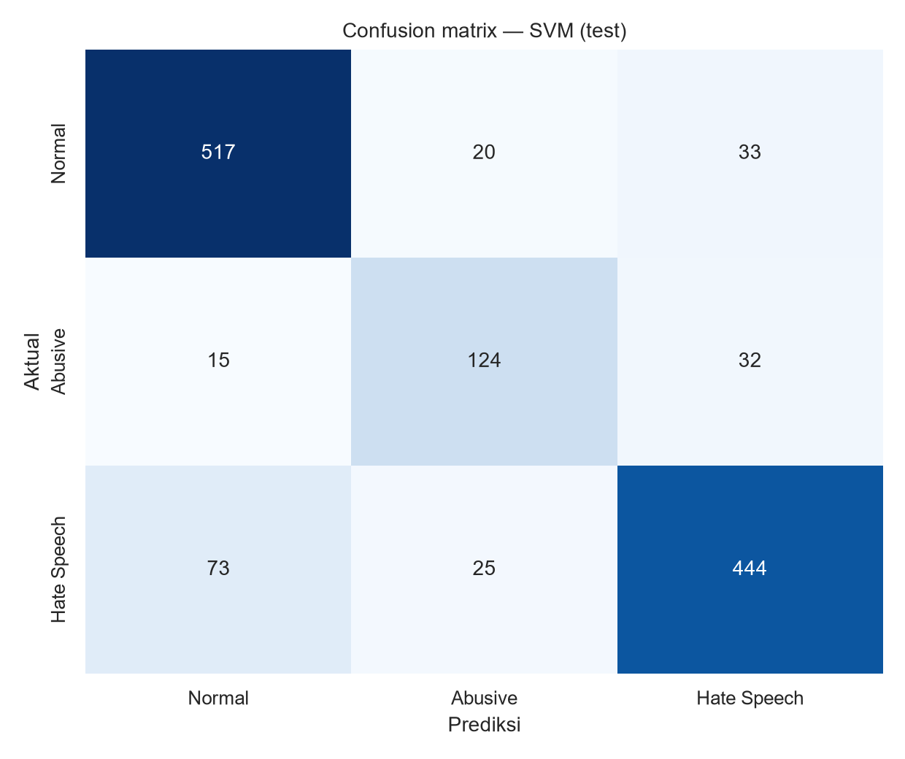

# Deteksi Ujaran Kebencian dan Bahasa Abusif pada Teks Bahasa Indonesia Menggunakan TF-IDF dan Perbandingan Tiga Model Klasik

**Tugas Besar Kecerdasan Buatan 2026**

| | |
|---|---|
| Kelompok | [isi nomor kelompok] |
| Anggota 1 | [Nama] / [NIM] |
| Anggota 2 | [Nama] / [NIM] |
| Anggota 3 | [Nama] / [NIM] |
| Anggota 4 | [Nama] / [NIM] |
| Program Studi | D4 Rekayasa Perangkat Lunak |
| Jurusan | Teknik Informatika, Politeknik Negeri Indramayu |
| Dosen | Vera Wati, M.Kom |
| Tanggal | November 2026 |

---

## Abstrak

Ujaran kebencian dan bahasa abusif di media sosial menimbulkan dampak sosial yang nyata, tetapi moderasi manual tidak lagi mampu mengikuti volume percakapan. Penelitian ini membangun pipeline klasifikasi teks bahasa Indonesia dan membandingkan tiga model klasik — Multinomial Naive Bayes, Regresi Logistik, dan Linear SVM — pada 13.169 tweet dataset Ibrohim dan Budi (2019). Setelah deduplikasi, 12.822 teks diproses melalui pembersihan karakter, normalisasi slang dengan kamus 15.151 entri, dan netralisasi nama tokoh politik. Representasi teks menggunakan TF-IDF gabungan word 1–2 gram dan char_wb 3–5 gram. Pemilihan hyperparameter dilakukan pada validation set, sedangkan test set hanya dipakai sekali. Pada skema tiga kelas (Normal, Abusive, Hate Speech), Linear SVM dengan C = 0,1 memberi hasil terbaik: akurasi 84,57% dan macro-F1 0,8181, dengan kelas Abusive sebagai yang tersulit (F1 0,7294).Untuk menguji daya generalisasi, model diuji pada 24 kalimat bergaya 2026: akurasi turun ke 58,3%, dan 7 dari 8 hinaan langsung salah diklasifikasi sebagai Hate Speech. Penelusuran label menunjukkan penyebabnya bukan arsitektur model — 64,7% teks yang mengandung kata hinaan memang dilabeli Hate Speech, dan bahkan classifier khusus Abusive vs Hate Speech hanya mengenali 2 dari 8 hinaan. Karena batas antar-kelas tidak konsisten di data, skema final disederhanakan menjadi biner Normal vs Kebencian/Abusif, yang mencapai akurasi 89,01% dan macro-F1 0,8893 pada test set serta 83,3% pada uji 2026. Hasil ini menunjukkan bahwa kualitas definisi label membatasi performa lebih kuat daripada pilihan algoritma.

**Kata kunci:** ujaran kebencian, bahasa Indonesia, TF-IDF, Naive Bayes, SVM, generalisasi lintas waktu

---

## 1. Pendahuluan

### 1.1 Latar belakang dan permasalahan

Percakapan publik di media sosial tumbuh jauh lebih cepat daripada kemampuan manusia memoderasinya. Sebuah unggahan dapat menerima ribuan komentar dalam hitungan jam, sementara tim moderasi biasanya hanya terdiri dari beberapa orang. Akibatnya, ujaran kebencian dan bahasa abusif sering lolos, menyebar, lalu memicu konflik lanjutan. Di Indonesia, persoalan ini bersinggungan dengan UU ITE, sehingga keputusan moderasi tidak bisa diserahkan sepenuhnya kepada model otomatis. Diperlukan sistem yang menyaring secara cepat, tetapi tetap menyediakan ruang bagi manusia untuk meninjau keputusan akhir.

Pendekatan berbasis daftar kata terlarang cepat usang: kata kasar dapat disamarkan dengan angka, singkatan, atau variasi ejaan, dan kata yang tampak kasar belum tentu ujaran kebencian. Pembelajaran mesin menawarkan jalan tengah karena model belajar pola dari data berlabel. Untuk bahasa Indonesia, benchmark yang paling banyak dipakai adalah dataset multilabel Ibrohim dan Budi (2019) berisi 13.169 tweet.

### 1.2 Tujuan pengembangan

1. Mengimplementasikan pipeline klasifikasi teks *end-to-end*, dari akuisisi data sampai demo web.
2. Membandingkan Multinomial Naive Bayes, Regresi Logistik, dan Linear SVM dengan protokol evaluasi terkontrol.
3. Menganalisis sumber kesalahan dan keterbatasan dataset, termasuk pengujian pada kalimat bergaya 2026.
4. Menyediakan baseline yang dapat dikembangkan menjadi sistem moderasi berbantuan manusia.

### 1.3 Deskripsi singkat sistem

Sistem terdiri atas tiga bagian. Pertama, pipeline pelatihan yang mengubah CSV mentah menjadi model `.joblib`. Kedua, API FastAPI (`app/main.py`) yang memuat model dan mengembalikan label, confidence, serta token yang memengaruhi prediksi. Ketiga, antarmuka web brutalist (`public/index.html`) yang dapat dipakai penguji untuk mengetik teks dan melihat hasilnya secara langsung. Model final yang dipakai demo adalah Linear SVM biner Normal vs Kebencian/Abusif.

### 1.4 Metode/algoritma yang dipilih

Representasi teks memakai **TF-IDF** gabungan word 1–2 gram dan char_wb 3–5 gram. Tiga classifier dibandingkan: **Multinomial Naive Bayes** (probabilistik), **Regresi Logistik** (memaksimalkan likelihood), dan **Linear SVM** (memaksimalkan margin). Model final dipilih dari macro-F1 pada validation set, bukan dari test set.

---

## 2. Dataset dan Permasalahan

### 2.1 Sumber dan deskripsi dataset

Dataset berasal dari repositori GitHub Ibrohim dan Budi (2019), *Multi-label Hate Speech and Abusive Language Detection in Indonesian Twitter*, lisensi CC BY-NC-SA 4.0. Data dikumpulkan dari Twitter pada 2018–2019 dan dianotasi secara multilabel oleh peneliti. Dataset diunduh otomatis oleh `src/download_data.py`, bersama dua berkas pendukung: `new_kamusalay.csv` (kamus slang) dan `abusive.csv` (leksikon kata abusif).

### 2.2 Jumlah data, atribut, dan tipe data

| Aspek | Nilai |
|---|---|
| Jumlah baris | 13.169 |
| Jumlah kolom | 13 (1 teks + 12 label) |
| Missing value | 0 |
| Duplikat teks (mentah) | 146 baris |
| Duplikat setelah normalisasi | 341 baris |
| Baris unik final | 12.822 |
| Kelas target | 3 kelas turunan |

Tipe data: satu kolom `object` (teks) dan 12 kolom `int64` berisi 0/1.

### 2.3 Atribut yang digunakan dan variabel input/target

| Kolom | Tipe | Peran | Keterangan |
|---|---|---|---|
| `Tweet` | string | **input** | teks tweet mentah |
| `HS` | 0/1 | label | ujaran kebencian |
| `Abusive` | 0/1 | label | bahasa abusif |
| `HS_Individual` … `HS_Strong` | 0/1 | tidak dipakai | rincian jenis target dan tingkat keparahan |

**Variabel input (X):** kolom `text_final`, yaitu teks setelah praproses.
**Variabel target (y):** turunan dari `HS` dan `Abusive` dengan aturan berurutan — `HS=1` menjadi Hate Speech, `Abusive=1` tanpa `HS` menjadi Abusive, sisanya Normal. Skema final untuk demo menggabungkan keduanya menjadi `Normal` vs `Kebencian/Abusif`.

### 2.4 Contoh data dan visualisasi awal

Contoh tiga baris pertama:

| text_final | label |
|---|---|
| "dasar cebong munafik kalian semua harus pergi" | Hate Speech |
| "dasar anjing kau" | Abusive |
| "program makan bergizi gratis sudah jalan di sekolah anak saya" | Normal |


*Gambar 1. Distribusi kelas: Normal 44,43%, Abusive 13,33%, Hate Speech 42,24%.*

Visualisasi awal menunjukkan ketidakseimbangan: kelas Abusive hanya 13,3% dari data, sementara dua kelas lain hampir seimbang. Ini menjadi alasan macro-F1 dipilih sebagai metrik utama.

### 2.5 Audit kualitas data

| Pemeriksaan | Temuan | Tindakan |
|---|---|---|
| Missing value | 0 pada seluruh kolom | tidak diperlukan imputasi |
| Duplikat teks mentah | 146 baris | dihapus |
| Duplikat setelah normalisasi | 341 baris | dihapus sebelum split |
| Tipe data | konsisten (`object` + `int64`) | tidak ada koreksi |
| Rentang label | hanya 0 dan 1 | valid |
| Outlier panjang teks | maksimum 143 kata | dipertahankan, bukan kesalahan |
| Nilai tidak valid | teks kosong setelah cleaning | dibuang |
| Kebocoran data | duplikat dihapus **sebelum** split | terkendali |

### 2.6 Keterkaitan dataset dengan permasalahan

Dataset menyediakan teks asli media sosial beserta anotasi manusia, sehingga cocok untuk tugas klasifikasi terawasi: model dapat belajar pola leksikal dan frasa yang membedakan teks netral, kasar, dan menyerang kelompok. Namun dataset ini juga membawa dua persoalan yang harus dijawab penelitian: (a) anotasi bersifat multilabel sehingga batas antar-kelas tidak selalu tegas, dan (b) data berasal dari 2018–2019 sehingga relevansinya untuk 2026 perlu diuji, bukan diasumsikan.

---

## 3. Pipeline Pengembangan AI

### 3.1 Flowchart pipeline umum



*Gambar 2. Pipeline 12 tahap, dari identifikasi masalah sampai output akhir. Panah oranye menunjukkan iterasi bila hasil evaluasi belum layak.*

### 3.2 Flowchart mekanisme internal algoritma



*Gambar 3. Mekanisme internal: teks → praproses → token → dua vektor TF-IDF → gabungan → skor linear → keputusan margin.*

### 3.3 Tahap 1 — Problem identification

**Konsep.** Tahap ini menentukan jenis masalah, tujuan, ruang lingkup, dan pengguna sasaran. Dari uraian pada Bab 1, masalahnya adalah **klasifikasi teks** (bukan regresi, klastering, atau pencarian) karena keluarannya berupa label diskret dari himpunan terbatas.

**Implementasi.** Keputusan ini tercermin pada struktur data: `X` berupa teks, `y` berupa kelas kategorikal, dan metrik yang dipakai adalah metrik klasifikasi (accuracy, precision, recall, F1). Tidak ada fungsi objektif kontinu yang perlu dioptimalkan seperti pada regresi.

**Hasil dan analisis.** Ruang lingkup dibatasi pada teks bahasa Indonesia dari Twitter, tiga kelas, dan model klasik. Pengguna sasaran adalah tim moderasi yang membutuhkan penyaring awal, serta peneliti yang membutuhkan baseline.

### 3.4 Tahap 2 — Data acquisition

**Konsep.** Dataset publik dipilih agar penelitian dapat direproduksi dan hasilnya dapat dibandingkan.

**Implementasi.** `src/download_data.py` mengunduh tiga berkas dari repositori GitHub resmi tanpa autentikasi API:

```python
FILES = {
    "re_dataset.csv": RAW_BASE + "re_dataset.csv",
    "new_kamusalay.csv": RAW_BASE + "new_kamusalay.csv",
    "abusive.csv": RAW_BASE + "abusive.csv",
}
```

**Hasil dan analisis.** Dataset mentah berisi 13.169 baris dan 13 kolom. Sebanyak 5.561 tweet berlabel `HS=1`, 5.043 berlabel `Abusive=1`, dan 5.860 tidak memiliki keduanya. Jumlah ini cukup untuk model linier dan validasi silang, tetapi tidak cukup untuk melatih transformer dari nol.

### 3.5 Tahap 3 — Data understanding dan quality assessment

**Konsep.** Sebelum diproses, data diperiksa dimensinya, tipe kolomnya, nilai hilang, duplikasi, dan konsistensi rentang nilai.

**Implementasi.** Pemeriksaan dijalankan oleh `src/eda_audit.py` dan menghasilkan `results/data_audit.csv`.

**Hasil dan analisis.** Tidak ada missing value; seluruh label berisi 0/1; duplikat teks ditemukan 146 baris mentah dan 341 baris setelah normalisasi. Tabel audit lengkap ada pada Bab 2.5. Temuan utama: kualitas data secara teknis bersih, tetapi kualitas **label** perlu diuji lebih jauh (dibahas pada Bab 4.5).

### 3.6 Tahap 4 — Exploratory data analysis

**Konsep.** EDA bertujuan memahami sebaran dan karakter tiap kelas sebelum pemodelan.

**Implementasi.** `src/eda_audit.py` menghitung statistik deskriptif dan boxplot; `src/train.py` menghasilkan histogram panjang teks dan kata terbanyak per kelas.

**Hasil.** Statistik jumlah kata setelah praproses:

| Kelas | n | Mean | Median | Modus | Std | Min | Max |
|---|---:|---:|---:|---:|---:|---:|---:|
| Normal | 5.697 | 20,97 | 19 | 11 | 12,26 | 1 | 80 |
| Abusive | 1.709 | 14,14 | 10 | 5 | 12,00 | 1 | 143 |
| Hate Speech | 5.416 | 15,86 | 14 | 10 | 10,17 | 1 | 67 |
| Gabungan | 12.822 | 17,90 | 15 | 10 | 11,73 | 1 | 143 |



*Gambar 4. Boxplot panjang teks per kelas; titik di luar whisker adalah outlier.*

**Analisis.** Teks Normal cenderung lebih panjang (median 19 kata) daripada Abusive (10 kata). Ini masuk akal: hinaan singkat seperti "dasar tolol" adalah pola khas Abusive, sedangkan teks Normal lebih bercerita. Outlier ekstrem (143 kata) dipertahankan karena bukan kesalahan input, melainkan variasi alami. Korelasi antar-variabel tidak dihitung karena dataset hanya memiliki satu variabel teks dan label kategorikal; matriks korelasi tidak bermakna pada data semacam ini.

### 3.7 Tahap 5 — Data preprocessing

**Konsep.** Teks media sosial tidak mengikuti ejaan baku, sehingga perlu dinormalisasi tanpa menghapus sinyal pembeda.

**Implementasi.** `basic_clean` dan `normalize_slang` pada `src/preprocess.py` menjalankan delapan langkah:

```python
text = text.lower()
text = URL_RE.sub(" ", text)          # hapus URL
text = MENTION_RE.sub(" ", text)      # hapus @mention
text = HASHTAG_RE.sub(r" \1 ", text)  # hashtag -> kata
text = REPEATED_CHAR_RE.sub(r"\1", text)  # goblokkk -> goblok
text = NON_LETTER_RE.sub(" ", text)   # hapus non-alfabet
text = normalize_slang(text, slang)   # 15.151 entri
text = neutralize_entities(text)      # hapus nama tokoh politik
```

**Hasil.** Perbandingan sebelum dan sesudah:

| Aspek | Sebelum | Sesudah |
|---|---:|---:|
| Jumlah baris | 13.169 | 12.822 |
| Duplikat | 341 | 0 |
| Missing teks | 0 | 0 |
| Median jumlah kata | 15 | 15 |
| Rata-rata jumlah kata | 17,28 | 17,90 |
| Kosakata unik | 45.947 | 19.147 |

**Analisis.** Kosakata menyusut 58% karena normalisasi slang dan penghapusan noise, tetapi panjang teks relatif stabil — artinya praproses memadatkan variasi ejaan tanpa membuang isi. Netralisasi 42 nama tokoh politik ditambahkan karena tanpa langkah itu model menghafal nama sebagai proksi kubu politik: kata "Jokowi" saja menghasilkan skor Hate Speech 87,6%.

### 3.8 Tahap 6 — Data transformation dan feature engineering

**Konsep.** TF-IDF memberi bobot pada term berdasarkan frekuensi dalam dokumen dan kelangkaannya di korpus:

\[
\text{tf-idf}(t,d) = \text{tf}(t,d) \times \text{idf}(t), \qquad
\text{idf}(t) = \log\frac{1+N}{1+\text{df}(t)} + 1
\]

**Implementasi.** Dua vectorizer digabung dengan `FeatureUnion`:

```python
word = TfidfVectorizer(analyzer="word", ngram_range=(1, 2),
                       min_df=3, max_df=0.95, max_features=50_000,
                       sublinear_tf=True)
char = TfidfVectorizer(analyzer="char_wb", ngram_range=(3, 5),
                       min_df=3, max_features=50_000, sublinear_tf=True)
features = FeatureUnion([("word", word), ("char", char)])
```

**Hasil.** Dokumentasi fitur sebelum dan sesudah transformasi:

| Tahap | Representasi | Dimensi |
|---|---|---:|
| Teks mentah | urutan karakter | bervariasi |
| Setelah praproses | urutan token | median 15 token |
| Word TF-IDF 1–2 gram | vektor sparse | 15.315 |
| Char_wb TF-IDF 3–5 gram | vektor sparse | 34.593 |
| Gabungan | vektor sparse | **49.908** |

**Analisis.** Word n-gram menangkap frasa seperti "ganti presiden", sedangkan char_wb menangkap variasi ejaan: `goblok`, `goblokk`, dan `goblokkk` memiliki irisan karakter yang besar. Seleksi fitur tidak dilakukan secara manual; pembatasan `min_df=3` dan `max_df=0.95` sudah membuang term yang terlalu jarang atau terlalu umum, sehingga dimensi turun dari puluhan ribu kandidat menjadi 49.908 fitur yang informatif.

### 3.9 Tahap 7 — Data preparation

**Konsep.** Data dibagi menjadi train, validation, dan test agar pemilihan model tidak menyentuh data evaluasi.

**Implementasi.** Split 80/10/10 dengan stratifikasi pada label:

```python
X_train, X_temp, y_train, y_temp = train_test_split(
    X, y, test_size=0.2, stratify=y, random_state=42)
X_val, X_test, y_val, y_test = train_test_split(
    X_temp, y_temp, test_size=0.5, stratify=y_temp, random_state=42)
```

**Hasil.** Train 10.257 teks, validation 1.282 teks, test 1.283 teks. Proporsi kelas terjaga di ketiga subset.

**Analisis.** Validation dipakai untuk memilih hyperparameter dan jumlah epoch; test hanya dipakai sekali di akhir. Setelah konfigurasi terbaik ditemukan, model dilatih ulang pada train + validation (90% data) lalu dievaluasi pada test, sehingga model final memanfaatkan data sebanyak mungkin tanpa mengorbankan independensi test.

### 3.10 Tahap 8 — AI method design

**Konsep.** Tiga model mewakili tiga cara berpikir: probabilistik (NB), likelihood (LR), dan margin (SVM).

**Multinomial Naive Bayes** mengasumsikan independensi fitur:

\[
P(c \mid d) \propto P(c) \prod_{j=1}^{m} P(t_j \mid c)
\]

**Regresi Logistik** memodelkan probabilitas kelas lewat softmax:

\[
P(y=c \mid x) = \frac{\exp(w_c^\top x + b_c)}{\sum_{k} \exp(w_k^\top x + b_k)}
\]

**Linear SVM** memaksimalkan margin dengan soft margin:

\[
\min_{w,b,\xi} \frac{1}{2}\|w\|^2 + C \sum_{i=1}^{N} \xi_i
\quad \text{dengan} \quad y_i(w^\top x_i + b) \ge 1 - \xi_i
\]

**Perhitungan manual (ilustrasi).** Misalkan korpus berisi tiga dokumen: d1 = "dasar tolol", d2 = "dasar cebong", d3 = "makan siang". Untuk dokumen d1 dan dua term pertama:

| Term | df | idf = ln((1+N)/(1+df)) + 1 | tf | tf-idf |
|---|---:|---:|---:|---:|
| dasar | 2 | ln(4/3) + 1 = 1,288 | 1 | 1,288 |
| tolol | 1 | ln(4/2) + 1 = 1,693 | 1 | 1,693 |

Vektor d1 menjadi \(x = [1{,}288;\ 1{,}693]\). Dengan bobot ilustratif \(w_{\text{Abusive}} = [0{,}8;\ 1{,}1]\), \(b = -0{,}5\):

\[
\text{score}_{\text{Abusive}} = 0{,}8(1{,}288) + 1{,}1(1{,}693) - 0{,}5 = 2{,}392
\]

\[
\text{score}_{\text{Hate}} = 0{,}9(1{,}288) - 0{,}2(1{,}693) - 0{,}3 = 0{,}520
\]

Karena \(2{,}392 > 0{,}520\), dokumen diprediksi **Abusive**. Angka bobot di atas hanya ilustrasi mekanisme; bobot sebenarnya berasal dari proses fitting.

**Rancangan eksperimen.** Grid hyperparameter: NB \(\alpha \in \{0{,}1; 0{,}5; 1{,}0\}\), LR \(C \in \{0{,}5; 1; 5\}\), SVM \(C \in \{0{,}1; 0{,}5; 1; 2\}\). Kriteria keberhasilan: macro-F1 validation tertinggi, dengan syarat tidak ada penurunan pada kelas minoritas.

### 3.11 Tahap 9 — Model implementation

**Konsep.** Implementasi memakai `scikit-learn` agar pipeline dapat direproduksi dan hyperparameter mudah ditukar.

**Implementasi.** `src/train.py` membangun pipeline dengan `FeatureUnion` dan classifier, lalu menyimpan model terbaik. Untuk demo, `src/train_binary.py` menjalankan pipeline yang sama dengan label biner.

```python
pipeline = Pipeline([
    ("features", make_vectorizer()),
    ("clf", LinearSVC(C=0.1, class_weight="balanced", max_iter=5000)),
])
pipeline.fit(X_train_full, y_train_full)
joblib.dump(pipeline, "models/best_model.joblib")
```

**Hasil.** Model tersimpan berukuran sekitar 3 MB dan memuat 49.908 fitur. Training satu model memakan waktu kurang dari dua menit pada CPU.

**Analisis.** Seluruh praproses disimpan di luar model (fungsi Python), sedangkan vectorizer berada di dalam pipeline. Ini penting: saat inference, teks harus melewati fungsi praproses yang sama, lalu pipeline melakukan transformasi dan prediksi. Jika vectorizer dipisah, risiko *train-serve skew* meningkat.

### 3.12 Tahap 10 — Testing dan experimentation

**Konsep.** Pengujian harus memakai data yang tidak dipakai melatih dan harus dapat direproduksi.

**Implementasi.** Tiga skenario dijalankan: (a) grid hyperparameter pada validation, (b) evaluasi sekali pada test 1.283 teks, (c) uji generalisasi pada 24 kalimat bergaya 2026 yang disusun manual. Seluruh proses memakai `random_state=42`.

**Hasil.** Validation memilih SVM \(C=0{,}1\) pada skema tiga kelas (macro-F1 0,7490) dan pada skema biner (0,8635). Validasi silang 5-fold memberi 0,7816 ± 0,0081 (tiga kelas) dan 0,8638 ± 0,0073 (biner).

**Analisis.** Hasil tuning stabil: selisih antar-fold kecil, sehingga pemilihan hyperparameter tidak bergantung pada satu split kebetulan. Uji 2026 sengaja memakai kalimat baru yang tidak ada di dataset, untuk mengukur apakah model belajar konsep atau hanya menghafal kosakata.

### 3.13 Tahap 11 — Evaluation dan error analysis

**Konsep.** Karena kelas tidak seimbang, metrik utama adalah macro-F1.

\[
\text{macro-F1} = \frac{1}{K}\sum_{k=1}^{K} F1_k, \qquad
F_1 = \frac{2PR}{P+R}
\]

**Implementasi.** `classification_report`, `confusion_matrix`, dan tabel kesalahan per pasangan kelas dihitung dari `results/test_predictions.csv`.

**Hasil.** Skema biner: macro-F1 0,8893 dan akurasi 89,01%. Skema tiga kelas: macro-F1 0,8181. Pada uji 2026: 58,3% (tiga kelas) dan 83,3% (biner). Rincian ada pada Bab 4.

**Analisis.** Selisih antara skor test dan skor 2026 jauh lebih besar pada skema tiga kelas (23 poin) daripada biner (5,7 poin). Stabilitas ini lebih penting daripada selisih tipis antar-algoritma.

### 3.14 Tahap 12 — Final output

**Konsep.** Keluaran akhir harus dapat dipakai, bukan hanya angka.

**Implementasi.** Model disimpan sebagai `models/best_model.joblib`, disajikan lewat `POST /api/predict`, dan ditampilkan pada antarmuka web. Endpoint `GET /api/model-info` membaca metrik dari `results/metrics.json`, sedangkan `GET /api/diagnostics` membantu memeriksa apakah model dan data termuat.

**Hasil.** Demo berjalan lokal di `http://localhost:8000` dan dapat dideploy ke Vercel. Contoh keluaran:

| Input | Output | Confidence |
|---|---|---:|
| "Dasar cebong munafik, kalian semua harus pergi" | Kebencian/Abusif | 94,7% |
| "Program makan bergizi gratis sudah jalan di sekolah anak saya" | Normal | 90,4% |
| "Kamu goblok banget sih, sudah dijelaskan masih nanya" | Kebencian/Abusif | 88,9% |

**Analisis.** Sistem memenuhi tujuan sebagai penyaring awal: ia memisahkan teks yang perlu ditinjau manusia dari yang tidak, dan menyertakan alasan token agar keputusannya dapat diperiksa.

---

## 4. Pengujian dan Evaluasi

### 4.1 Skenario dan data pengujian

| Skenario | Data | Ukuran | Tujuan |
|---|---|---:|---|
| Grid hyperparameter | train → validation | 10.257 → 1.282 | memilih konfigurasi |
| Evaluasi utama | test | 1.283 | mengukur performa akhir |
| Validasi silang | train | 10.257 (5 fold) | mengukur stabilitas |
| Generalisasi 2026 | probe manual | 24 kalimat | mengukur *domain shift* |

Probe 2026 disusun tim dan dilabeli sendiri, sehingga bersifat indikatif, bukan test set resmi. Kalimatnya membahas isu terkini: program makan bergizi, efisiensi anggaran, judi online, pinjaman online, dan politik 2024–2026.

### 4.2 Hasil implementasi dan output sistem

Perbandingan model pada test set:

**Skema tiga kelas** (studi pembanding):

| Model | Konfigurasi | Val macro-F1 | Test accuracy | Test macro-F1 |
|---|---|---:|---:|---:|
| Multinomial NB | \(\alpha=0,5\) | 0,7268 | 81,76% | 0,7710 |
| Regresi Logistik | \(C=5,0\) | 0,7444 | 84,96% | 0,8189 |
| Linear SVM | \(C=0,1\) | **0,7490** | 84,57% | 0,8181 |

**Skema biner** (model final):

| Model | Konfigurasi | Val macro-F1 | Test accuracy | Test macro-F1 |
|---|---|---:|---:|---:|
| Multinomial NB | \(\alpha=0,5\) | 0,8379 | 86,05% | 0,8573 |
| Regresi Logistik | \(C=5,0\) | 0,8610 | 88,70% | 0,8860 |
| Linear SVM | \(C=0,1\) | **0,8635** | **89,01%** | **0,8893** |

Per kelas untuk model final:

| Kelas | Precision | Recall | F1 | Support |
|---|---|---:|---:|---:|
| Normal | 0,8557 | 0,9053 | 0,8798 | 570 |
| Kebencian/Abusif | 0,9206 | 0,8780 | 0,8988 | 713 |
| **Macro avg** | **0,8882** | **0,8916** | **0,8893** | **1.283** |


*Gambar 5. Confusion matrix model final biner pada 1.283 teks uji.*

### 4.3 Metrik evaluasi

| Metrik | Nilai | Alasan dipakai |
|---|---:|---|
| Accuracy | 89,01% | gambaran umum, mudah dibaca |
| Macro-F1 | **0,8893** | metrik utama; memberi bobot sama tiap kelas |
| Precision (Kebencian) | 0,9206 | mengukur false positive |
| Recall (Kebencian) | 0,8780 | mengukur konten yang lolos |
| Cross-validation | 0,8638 ± 0,0073 | stabilitas antar-fold |
| Akurasi probe 2026 | 83,3% | daya generalisasi |

Macro-F1 dipilih karena accuracy dapat menyesatkan pada data tidak seimbang. Contoh nyata: skema tiga kelas pada dataset ini memiliki accuracy 84,57%, tetapi macro-F1 hanya 0,8181.

### 4.4 Perbandingan hasil eksperimen

| Perbandingan | Selisih macro-F1 |
|---|---:|
| NB → SVM (tiga kelas) | +0,047 |
| NB → SVM (biner) | +0,032 |
| Tiga kelas → biner (SVM) | **+0,071** |

Selisih antar-algoritma lebih kecil daripada selisih antar-skema label. Ini temuan penting: pada penelitian ini, **keputusan definisi label** berdampak lebih besar daripada **pemilihan algoritma**.

Perbandingan generalisasi:

| Skema | Test 2019 | Probe 2026 | Selisih |
|---|---:|---:|---:|
| Tiga kelas | 84,57% | 58,3% | **−26,3 poin** |
| Biner | 89,01% | 83,3% | **−5,7 poin** |

### 4.5 Analisis kesalahan

Pada skema tiga kelas, dari 1.283 teks uji terdapat 1.085 prediksi benar dan 198 salah:

| Aktual \ Prediksi | Normal | Abusive | Hate Speech |
|---|---:|---:|---:|
| **Normal** | **517** | 20 | 33 |
| **Abusive** | 15 | **124** | 32 |
| **Hate Speech** | 73 | 25 | **444** |

Pola utama: **Hate Speech → Normal** (73 teks) terjadi karena banyak ujaran kebencian tidak memakai kata kasar eksplisit; **Abusive → Hate Speech** (32 teks) menunjukkan batas yang paling kabur.

Pada uji 2026, pola kesalahannya jauh lebih tajam: dari 8 hinaan langsung, 7 diprediksi Hate Speech. Penelusuran menemukan sebabnya pada data, bukan pada model:

| Pemeriksaan | Hasil |
|---|---:|
| Teks mengandung kata hinaan yang dilabeli Hate Speech | 64,7% |
| Teks berhinaan **tanpa** menyebut kelompok, tetap dilabeli Hate Speech | 58% |
| Hinaan yang dikenali classifier khusus Abusive vs Hate | 2 dari 8 |

Artinya, aturan "tanpa target kelompok = Abusive" tidak dipakai saat anotasi. Dataset aslinya multilabel: satu tweet dapat ditandai `HS=1` sekaligus `Abusive=1`, dan pemetaan ke tiga kelas memprioritaskan `HS`. Tidak ada algoritma yang dapat menebak aturan yang tidak konsisten di datanya.



*Gambar 6. Confusion matrix model tiga kelas pada 1.283 teks uji.*

### 4.6 Keterbatasan sistem

1. **Validitas konstruk.** 64,7% teks berhinaan dilabeli Hate Speech, sehingga batas Abusive–Hate Speech tidak dapat dipelajari secara konsisten.
2. **Validitas eksternal.** Sudah diukur: akurasi turun dari 84,57% (test 2019) ke 58,3% (probe 2026) pada skema tiga kelas, dan dari 89,01% ke 83,3% pada skema biner.
3. **Ukuran probe.** Hanya 24 kalimat dan dilabeli tim sendiri, sehingga belum punya interval kepercayaan.
4. **Bias entitas.** Nama tokoh sudah dinetralkan, tetapi kata seperti *cebong* dan *kampret* masih menjadi sinyal kuat.
5. **Kalibrasi.** Skor SVM bukan probabilitas terkalibrasi; angka "94,7%" adalah hasil softmax atas margin, bukan peluang sebenarnya.
6. **Kebocoran data.** Duplikat dihapus sebelum split dan vectorizer di-*fit* hanya pada data latih, sehingga risiko kebocoran terkendali.
7. **Etika.** Model dapat bias terhadap kelompok tertentu karena data historis; keputusan akhir harus melibatkan manusia.

---

## 5. Kesimpulan

### 5.1 Ringkasan hasil

Pipeline klasifikasi ujaran kebencian bahasa Indonesia berhasil dibangun dari data mentah sampai demo web. Tiga model klasik dibandingkan dengan protokol terkontrol: hyperparameter dipilih pada validation, dan test hanya dipakai sekali. Pada skema tiga kelas, Linear SVM memberi macro-F1 0,8181 dan akurasi 84,57%. Pada skema biner yang dipakai demo, Linear SVM memberi macro-F1 0,8893 dan akurasi 89,01%.

### 5.2 Ketercapaian tujuan dan manfaat

| Tujuan | Status | Bukti |
|---|---|---|
| Pipeline end-to-end | tercapai | `src/download_data.py` → `models/best_model.joblib` |
| Perbandingan tiga model | tercapai | Tabel 4.2 |
| Analisis kesalahan & keterbatasan | tercapai | Bab 4.5 dan 4.6 |
| Baseline untuk moderasi | tercapai | Demo web + API |

Manfaat praktisnya: model linier dengan TF-IDF cukup murah untuk dijalankan di server kecil, dan penjelasan token membuat keputusannya dapat diperiksa manusia.

### 5.3 Hasil evaluasi metode

| Metode | Macro-F1 (3 kelas) | Macro-F1 (biner) |
|---|---:|---:|
| Multinomial Naive Bayes | 0,7710 | 0,8573 |
| Regresi Logistik | 0,8189 | 0,8860 |
| **Linear SVM** | **0,8181** | **0,8893** |

SVM dipilih karena konsisten tertinggi pada validation di kedua skema. Namun temuan yang lebih penting: **kualitas definisi label membatasi performa lebih kuat daripada pilihan algoritma**. Selisih antar-algoritma hanya 0,032–0,047, sedangkan selisih antar-skema label mencapai 0,071.

### 5.4 Keterbatasan dan saran

1. **Perbaiki aturan anotasi.** Sepakati definisi eksplisit (misalnya: ada target kelompok atau tidak) dan ukur agreement antar-anotator sebelum menambah model.
2. **Perluas uji temporal.** Naikkan probe 2026 menjadi 100–200 kalimat dengan dua anotator independen.
3. **Kalibrasi probabilitas.** Gunakan Platt scaling atau isotonic regression.
4. **Tahap kedua opsional.** Bila anotasi sudah konsisten, tambahkan classifier Abusive vs Hate sebagai tahap kedua di atas model biner.
5. **Uji bias kelompok.** Ukur performa per kelompok sasaran sebelum dipakai di luar demonstrasi.

---

## Daftar Pustaka

Ibrohim, M. O., & Budi, I. (2019). Multi-label hate speech and abusive language detection in Indonesian Twitter. In *Proceedings of the Third Workshop on Abusive Language Online* (pp. 46–57). Association for Computational Linguistics. https://doi.org/10.18653/v1/W19-3506

Joachims, T. (1998). Text categorization with support vector machines: Learning with many relevant features. In *Machine Learning: ECML-98* (pp. 137–142). Springer. https://doi.org/10.1007/BFb0026683

Manning, C. D., Raghavan, P., & Schütze, H. (2008). *Introduction to information retrieval*. Cambridge University Press.

Pedregosa, F., et al. (2011). Scikit-learn: Machine learning in Python. *Journal of Machine Learning Research, 12*, 2825–2830.

Sastrawi. (n.d.). *Sastrawi: Indonesian stemmer library* [Perangkat lunak]. GitHub. https://github.com/sastrawi/sastrawi

---

## 6. Lampiran

### A. Source code

| Berkas | Fungsi |
|---|---|
| `src/download_data.py` | mengunduh dataset dan kamus |
| `src/preprocess.py` | cleaning, normalisasi slang, netralisasi entitas |
| `src/eda_audit.py` | audit kualitas data, statistik deskriptif, boxplot |
| `src/train.py` | training tiga kelas + tuning + evaluasi |
| `src/train_binary.py` | training model final biner + probe 2026 |
| `src/threshold_analysis.py` | analisis ambang indikasi hate |
| `src/inference.py` | prediksi + explainability token |
| `src/build_diagrams.py` | flowchart pipeline dan algoritma |
| `src/build_docx.py`, `src/build_slides.py` | generator laporan dan slide |
| `app/main.py`, `public/index.html` | API dan antarmuka demo |

Seluruh kode tersedia di repositori: https://github.com/rhsa-fr/ml-deteksi-ujaran-kebencian

### B. Dataset dan tautan

| Berkas | Sumber |
|---|---|
| `re_dataset.csv` | https://github.com/oktaviacitra/commented-hate-speech (mirror Ibrohim & Budi, 2019) |
| `new_kamusalay.csv` | repositori yang sama |
| `abusive.csv` | repositori yang sama |

Lisensi: CC BY-NC-SA 4.0 (akademik, non-komersial). Sitasi: Ibrohim & Budi (2019).

### C. Dokumentasi preprocessing dan EDA

- `results/data_audit.csv` — tipe, missing, unik per kolom.
- `results/deskriptif.csv` — statistik panjang teks per kelas.
- `results/preprocessing_audit.csv` — perbandingan sebelum/sesudah.
- `results/eda_class_distribution.png`, `results/eda_text_length.png`, `results/eda_boxplot.png`, `results/eda_top_words.png`.

### D. Diagram pipeline

- `results/pipeline_umum.png` — flowchart 12 tahap.
- `results/algoritma_linear_svm.png` — mekanisme internal algoritma.
- `results/pipeline_diagram.png` — versi ringkas 7 tahap.

### E. Hasil pengujian dan evaluasi

- `results/metrics.json` — metrik model final biner.
- `results/metrics_3class.json` — metrik studi tiga kelas.
- `results/classification_report.txt`, `results/confusion_matrix.png`.
- `results/confusion_matrix_3class.png`, `results/classification_report_3class.txt`.
- `results/test_predictions.csv`, `results/error_analysis.csv`, `results/top_features.csv`.
- `results/probe_2026.csv` — 24 kalimat uji 2026 beserta prediksinya.

### F. Landasan teori

**Klasifikasi teks terawasi.** Diberikan data latih \(D = \{(x_i, y_i)\}_{i=1}^{N}\), tujuannya mempelajari \(f: \mathcal{X} \rightarrow \mathcal{Y}\) yang meminimalkan kesalahan pada data baru. Karena teks tidak dapat diolah langsung sebagai bilangan, setiap dokumen dipetakan menjadi vektor fitur; kualitas pemetaan ini sering lebih menentukan daripada kompleksitas model.

**Praproses bahasa Indonesia.** Teks media sosial tidak mengikuti ejaan baku. Praproses mengurangi variasi yang tidak informatif tanpa menghapus sinyal. Stopword sengaja tidak dihapus karena kata seperti *tidak*, *bukan*, dan *jangan* mengubah makna secara drastis.

**TF-IDF.** \(\text{tf-idf}(t,d) = \text{tf}(t,d) \times \text{idf}(t)\), dengan \(\text{idf}(t) = \log\frac{1+N}{1+\text{df}(t)} + 1\). Kata yang muncul di hampir semua dokumen memiliki IDF rendah; kata yang khas memiliki IDF tinggi.

**Naive Bayes.** \(P(c \mid d) \propto P(c) \prod_{j} P(t_j \mid c)\), dengan penghalusan Laplace untuk menghindari probabilitas nol.

**Regresi Logistik.** \(P(y=c \mid x) = \exp(w_c^\top x + b_c) / \sum_k \exp(w_k^\top x + b_k)\), dioptimalkan dengan meminimalkan cross-entropy.

**Linear SVM.** Memaksimalkan margin dengan soft margin; parameter \(C\) mengatur trade-off antara margin lebar dan toleransi kesalahan.

**Keterkaitan teori dan implementasi:**

| Teori | Implementasi | Bukti |
|---|---|---|
| Vector Space Model dan TF-IDF | `TfidfVectorizer` word + char_wb | `src/train.py` |
| Teorema Bayes dan Laplace | `MultinomialNB(alpha=...)` | model NB |
| Regresi multinomial | `LogisticRegression` | model LR |
| Margin maksimum | `LinearSVC(C=...)` | model SVM |
| Evaluasi klasifikasi | `classification_report` | `results/` |
| Explainability | koefisien × nilai TF-IDF | `src/inference.py` |

### G. Pernyataan etika

Seluruh teks contoh pada laporan disensor sebagian. Dataset hanya dipakai untuk penelitian akademik dan tidak untuk melakukan profiling individu. Model tidak dirancang sebagai alat penghukum; keputusan akhir harus melibatkan manusia.
