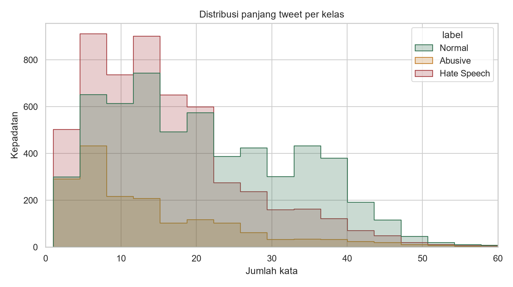
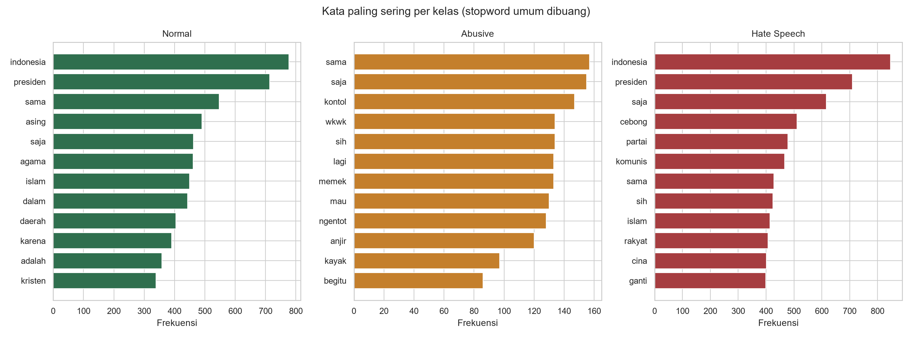

# Deteksi Ujaran Kebencian dan Bahasa Abusif pada Teks Bahasa Indonesia Menggunakan TF-IDF dan Perbandingan Tiga Model Klasik

**Tugas Besar Kecerdasan Buatan 2026**

| | |
|---|---|
| Kelompok | [isi nomor kelompok] |
| Anggota 1 | [Nama] / [NIM] |
| Anggota 2 | [Nama] / [NIM] |
| Anggota 3 | [Nama] / [NIM] |
| Anggota 4 | [Nama] / [NIM] |
| Program Studi | D4 Rekayasa Perangkat Lunak |
| Jurusan | Teknik Informatika, Politeknik Negeri Indramayu |
| Tanggal | November 2026 |

---

## Abstrak

Ujaran kebencian dan bahasa abusif di media sosial menimbulkan dampak sosial yang nyata, tetapi moderasi manual tidak lagi mampu mengikuti volume percakapan. Penelitian ini membangun pipeline klasifikasi teks bahasa Indonesia dan membandingkan tiga model klasik — Multinomial Naive Bayes, Regresi Logistik, dan Linear SVM — pada 13.169 tweet dataset Ibrohim dan Budi (2019). Setelah deduplikasi, 12.822 teks diproses melalui pembersihan karakter, normalisasi slang dengan kamus 15.151 entri, dan netralisasi nama tokoh politik. Representasi teks menggunakan TF-IDF gabungan word 1–2 gram dan char_wb 3–5 gram. Pemilihan hyperparameter dilakukan pada validation set, sedangkan test set hanya dipakai sekali. Pada skema tiga kelas (Normal, Abusive, Hate Speech), Linear SVM dengan C = 0,1 memberi hasil terbaik: akurasi 84,57% dan macro-F1 0,8181, dengan kelas Abusive sebagai yang tersulit (F1 0,7294). Untuk menguji daya generalisasi, model diuji pada 24 kalimat bergaya 2026: akurasi turun ke 58,3%, dan 7 dari 8 hinaan langsung salah diklasifikasi sebagai Hate Speech. Penelusuran label menunjukkan penyebabnya bukan arsitektur model — 64,7% teks yang mengandung kata hinaan memang dilabeli Hate Speech, dan bahkan classifier khusus Abusive vs Hate Speech hanya mengenali 2 dari 8 hinaan. Karena batas antar-kelas tidak konsisten di data, skema final disederhanakan menjadi biner Normal vs Kebencian/Abusif, yang mencapai akurasi 89,01% dan macro-F1 0,8893 pada test set serta 83,3% pada uji 2026. Hasil ini menunjukkan bahwa kualitas definisi label membatasi performa lebih kuat daripada pilihan algoritma.

**Kata kunci:** ujaran kebencian, bahasa Indonesia, TF-IDF, Naive Bayes, SVM, generalisasi lintas waktu

---

## 1. Pendahuluan

### 1.1 Latar belakang

Percakapan publik di media sosial tumbuh jauh lebih cepat daripada kemampuan manusia memoderasinya. Sebuah unggahan dapat menerima ribuan komentar dalam hitungan jam, sementara tim moderasi biasanya hanya terdiri dari beberapa orang. Akibatnya, ujaran kebencian dan bahasa abusif sering lolos, menyebar, lalu memicu konflik lanjutan. Di Indonesia, persoalan ini juga bersinggungan dengan kerangka hukum, khususnya pasal-pasal pencemaran nama baik dan ujaran kebencian di UU ITE, sehingga keputusan moderasi tidak bisa sepenuhnya diserahkan kepada model otomatis. Diperlukan sistem yang mampu menyaring secara cepat, tetapi tetap menyediakan ruang bagi manusia untuk meninjau keputusan akhir.

Pendekatan berbasis aturan dan daftar kata terlarang cepat usang. Kata kasar dapat disamarkan dengan angka, singkatan, atau variasi ejaan; sebaliknya, kata yang tampak kasar belum tentu merupakan ujaran kebencian karena sangat bergantung pada konteks. Pendekatan pembelajaran mesin menawarkan jalan tengah: model belajar pola dari data berlabel, bukan dari daftar kata yang ditulis manual. Untuk bahasa Indonesia, salah satu benchmark yang paling banyak dipakai adalah dataset multi-label dari Ibrohim dan Budi (2019) yang berisi 13.169 tweet dengan anotasi hate speech dan bahasa abusif.

Penelitian ini tidak hanya melatih satu model, tetapi membandingkan tiga model klasik yang mewakili tiga cara berpikir berbeda: Naive Bayes yang probabilistik, Regresi Logistik yang mengoptimalkan likelihood, dan Support Vector Machine yang memaksimalkan margin. Perbandingan ini penting karena pada data teks berdimensi tinggi dan relatif kecil, model linier sering kali kompetitif terhadap model yang jauh lebih kompleks. Dengan memahami mengapa sebuah model menang, kita dapat menjelaskan keterkaitan antara teori yang dipelajari di kelas dan keputusan implementasi yang diambil.

### 1.2 Rumusan masalah

1. Bagaimana membangun pipeline praproses yang sesuai untuk teks media sosial bahasa Indonesia yang mengandung slang, typo, dan kata berulang?
2. Seberapa baik TF-IDF dengan word dan char n-gram merepresentasikan teks untuk tugas klasifikasi ujaran kebencian?
3. Model mana di antara Multinomial Naive Bayes, Regresi Logistik, dan Linear SVM yang memberikan performa terbaik pada data uji, dan mengapa?
4. Kesalahan seperti apa yang masih dilakukan model, terutama pada kelas Abusive yang jumlahnya lebih sedikit?

### 1.3 Tujuan

1. Mengimplementasikan pipeline klasifikasi teks end-to-end, dari akuisisi data sampai demo web.
2. Membandingkan performa tiga model klasik dengan protokol evaluasi yang terkontrol.
3. Menganalisis sumber kesalahan model dan keterbatasan dataset.
4. Menyediakan baseline yang dapat dikembangkan menjadi sistem moderasi berbantuan manusia.

### 1.4 Manfaat

Bagi peneliti, penelitian ini menyediakan baseline dan analisis kesalahan yang dapat dibandingkan dengan model transformer. Bagi praktisi, pipeline ini menunjukkan bahwa model linier dengan TF-IDF masih layak dijadikan penyaring awal karena murah, cepat, dan mudah dijelaskan. Bagi pembelajaran, proyek ini mendemonstrasikan bagaimana teori representasi teks, probabilistik, optimasi margin, dan evaluasi bertemu dalam satu artefak yang dapat dijalankan.

### 1.5 Batasan

Penelitian ini dibatasi pada teks berbahasa Indonesia, skema tiga kelas dengan pembanding biner, dan data dari Twitter 2018–2019. Model tidak dirancang untuk video, audio, atau percakapan multi-turn. Keputusan model tidak dimaksudkan sebagai putusan final, melainkan sebagai sinyal awal yang harus ditinjau manusia.

---

## 2. Landasan Teori

### 2.1 Klasifikasi teks sebagai pembelajaran terawasi

Klasifikasi teks adalah tugas memberi label pada urutan token berdasarkan pola yang dipelajari dari contoh berlabel. Secara formal, diberikan himpunan data latih \(D = \{(x_i, y_i)\}_{i=1}^{N}\) dengan \(x_i\) adalah teks dan \(y_i \in \{\text{Normal}, \text{Abusive}, \text{Hate Speech}\}\). Tujuannya adalah mempelajari fungsi \(f: \mathcal{X} \rightarrow \mathcal{Y}\) yang meminimalkan kesalahan pada data yang belum pernah dilihat. Karena teks tidak dapat langsung diolah sebagai bilangan, setiap dokumen harus dipetakan terlebih dahulu menjadi vektor fitur. Kualitas pemetaan ini sering kali lebih menentukan daripada kompleksitas model.

### 2.2 Praproses teks bahasa Indonesia

Teks media sosial tidak mengikuti kaidah ejaan baku. Kata dapat disingkat (*yg*, *gak*, *bgt*), dipanjangkan (*bagusss*), atau dicampur dengan bahasa Inggris. Praproses bertujuan mengurangi variasi yang tidak informatif tanpa menghapus sinyal yang membedakan kelas. Pada penelitian ini, praproses mencakup case folding, penghapusan URL dan mention, penggantian karakter berulang, penghapusan non-alfabet, normalisasi slang, dan deduplikasi.

Satu keputusan penting adalah tidak menghapus stopword dan tidak menormalisasi kata abusif. Kata seperti *tidak*, *bukan*, dan *jangan* mengubah makna secara drastis; menghapusnya dapat membalik label. Kata abusif juga sengaja dipertahankan karena justru merupakan fitur pembeda antara kelas Normal dan Abusive.

### 2.3 Representasi TF-IDF

TF-IDF (*Term Frequency–Inverse Document Frequency*) memberi bobot pada kata berdasarkan seberapa sering kata muncul dalam dokumen dan seberapa langka kata itu di seluruh korpus. Bobot TF-IDF untuk term \(t\) pada dokumen \(d\) dirumuskan sebagai:

\[
\text{tf-idf}(t,d) = \text{tf}(t,d) \times \text{idf}(t)
\]

\[
\text{idf}(t) = \log\frac{1+N}{1+\text{df}(t)} + 1
\]

dengan \(N\) jumlah dokumen dan \(\text{df}(t)\) jumlah dokumen yang mengandung term \(t\). Kata yang muncul di hampir semua dokumen memiliki IDF rendah, sedangkan kata yang khas pada sedikit dokumen memiliki IDF tinggi. Pada implementasi ini, TF-IDF dihitung untuk dua jenis fitur: **word n-gram 1–2** yang menangkap frasa pendek, dan **char_wb n-gram 3–5** yang menangkap pola karakter dan awalan/akhiran. Char n-gram sangat membantu ketika ejaan tidak baku, misalnya *goblok*, *goblokk*, dan *goblokkk* memiliki irisan karakter yang besar.

### 2.4 Multinomial Naive Bayes

Naive Bayes mengasumsikan bahwa setiap fitur (kata) muncul secara independen dengan kelasnya. Meskipun asumsi ini jelas tidak benar dalam bahasa, model ini sering memberikan hasil yang kuat pada klasifikasi teks karena dimensinya tinggi dan datanya relatif kecil. Untuk kelas \(c\) dan dokumen \(d\) yang terdiri atas token \(t_1, \dots, t_m\):

\[
P(c \mid d) \propto P(c) \prod_{j=1}^{m} P(t_j \mid c)
\]

Probabilitas \(P(t_j \mid c)\) diestimasi dengan penghalusan Laplace (parameter \(\alpha\)) untuk menghindari probabilitas nol. Kelebihan model ini adalah latihannya sangat cepat dan mudah diinterpretasi; kelemahannya adalah asumsi independensi dan kecenderungannya kalah ketika fitur saling berkorelasi kuat.

### 2.5 Regresi Logistik

Regresi Logistik memodelkan probabilitas kelas sebagai fungsi linear dari fitur, lalu melewatkannya melalui softmax untuk masalah multikelas:

\[
P(y=c \mid x) = \frac{\exp(w_c^\top x + b_c)}{\sum_{k} \exp(w_k^\top x + b_k)}
\]

Parameter \(W\) dan \(b\) dioptimalkan dengan memaksimalkan likelihood (setara meminimalkan cross-entropy). Berbeda dari Naive Bayes, model ini tidak mengasumsikan independensi fitur, sehingga dapat menangkap korelasi antar-kata. Bobot \(w_c\) juga dapat dibaca sebagai kontribusi fitur terhadap kelas \(c\), yang membuat model ini berguna untuk analisis.

### 2.6 Support Vector Machine

SVM mencari hyperplane yang memisahkan kelas dengan margin terbesar. Untuk data yang tidak sepenuhnya terpisah, digunakan *soft margin* dengan variabel slack \(\xi_i\):

\[
\min_{w,b,\xi} \frac{1}{2}\|w\|^2 + C \sum_{i=1}^{N} \xi_i
\]

\[
\text{dengan } y_i(w^\top x_i + b) \ge 1 - \xi_i, \quad \xi_i \ge 0
\]

Parameter \(C\) mengontrol trade-off antara margin lebar dan toleransi kesalahan. Pada teks berdimensi tinggi, SVM linier sering sangat efektif karena data cenderung dapat dipisahkan secara linear di ruang fitur yang jarang. Selain itu, hanya sebagian kecil data yang menjadi *support vector*, sehingga prediksi relatif cepat.

### 2.7 Evaluasi model

Akurasi saja tidak cukup ketika kelas tidak seimbang. Pada data ini, kelas Abusive hanya 13,32% dari total, sehingga model yang selalu memprediksi Normal bisa terlihat memiliki akurasi tinggi tetapi tidak berguna. Oleh karena itu, metrik utama yang digunakan adalah **macro-F1**, yaitu rata-rata F1 setiap kelas tanpa mempertimbangkan jumlah sampel:

| Metrik | Rumus |
|---|---|
| Precision | \(P = TP / (TP + FP)\) |
| Recall | \(R = TP / (TP + FN)\) |
| F1 | \(F_1 = 2PR / (P + R)\) |

\[
\text{macro-F1} = \frac{1}{K}\sum_{k=1}^{K} F1_k
\]

Confusion matrix digunakan untuk melihat pola kesalahan antar-kelas, sedangkan validasi silang 5-fold pada data latih digunakan untuk mengukur stabilitas model.

### 2.8 Keterkaitan teori dan implementasi

| Teori | Implementasi | Bukti |
|---|---|---|
| Vector Space Model dan TF-IDF | `TfidfVectorizer` word + char_wb | `src/train.py` bagian `make_vectorizer` |
| Teorema Bayes dan penghalusan Laplace | `MultinomialNB(alpha=...)` | Model NB, tuning \(\alpha\) |
| Regresi multinomial dan cross-entropy | `LogisticRegression` | Model LR, `predict_proba` |
| Margin maksimum dan hinge loss | `LinearSVC(C=...)` | Model SVM, tuning \(C\) |
| Evaluasi klasifikasi | `classification_report`, `confusion_matrix` | `results/classification_report.txt` |
| Validasi model | `StratifiedKFold`, split 80/10/10 | `results/metrics.json` |
| Explainability | koefisien model × nilai TF-IDF | `src/inference.py`, `results/top_features.csv` |

---

## 3. Metodologi dan Implementasi

### 3.1 Desain pipeline

Pipeline penelitian ini terdiri atas tujuh tahap yang dapat direproduksi:


*Gambar 1. Diagram pipeline penelitian, dari dataset mentah sampai demo web.*

Setiap tahap dijelaskan dengan empat komponen yang diminta: konsep, implementasi, hasil, dan analisis.

### 3.2 Akuisisi data

**Konsep.** Dataset publik dipilih agar penelitian dapat direproduksi dan hasilnya dapat dibandingkan dengan penelitian lain. Dataset harus memiliki label yang relevan, teks asli, dan lisensi yang jelas.

**Implementasi.** Data diunduh dari repositori GitHub resmi Ibrohim dan Budi (2019) melalui `src/download_data.py`. Tiga berkas yang dipakai adalah `re_dataset.csv` (teks dan label), `new_kamusalay.csv` (kamus slang), dan `abusive.csv` (leksikon kata abusif). Tidak diperlukan autentikasi API.

**Hasil.** Dataset mentah berisi 13.169 baris dan 13 kolom: satu kolom teks dan 12 kolom label. Sebanyak 5.561 tweet berlabel `HS=1`, 5.043 berlabel `Abusive=1`, dan 5.860 tidak memiliki kedua label tersebut. Setelah deduplikasi teks, tersisa 12.828 baris unik (341 duplikat dibuang).

**Analisis.** Jumlah data cukup untuk melatih model linier dan melakukan validasi silang, tetapi tidak cukup besar untuk melatih transformer dari nol. Karena itu, pendekatan yang realistis adalah model klasik dengan fitur TF-IDF, atau transformer pra-terlatih yang di-*fine-tune* bila sumber daya tersedia. Deduplikasi penting dilakukan sebelum split agar teks yang sama tidak muncul di train dan test sekaligus, yang akan membuat skor evaluasi terlalu optimistis.

### 3.3 Pemetaan label

**Konsep.** Dataset asli bersifat multilabel: satu tweet dapat sekaligus mengandung ujaran kebencian dan bahasa abusif. Untuk tugas ini, label dipetakan menjadi tiga kelas yang saling eksklusif agar evaluasi lebih sederhana dan interpretatif.

**Implementasi.** Aturan pemetaan pada `src/preprocess.py`:

```python
def map_label(row):
    if int(row["HS"]) == 1:
        return "Hate Speech"
    if int(row["Abusive"]) == 1:
        return "Abusive"
    return "Normal"
```

**Hasil.** Distribusi akhir: Normal 5.697 (44,43%), Abusive 1.709 (13,33%), Hate Speech 5.416 (42,24%). Setelah netralisasi nama tokoh politik, dua teks menjadi duplikat sehingga total berkurang dari 12.828 menjadi 12.822.

**Analisis.** Pemetaan ini mengorbankan informasi target ujaran (agama, ras, gender) dan tingkat keparahan, tetapi menghasilkan kelas yang lebih seimbang dan cukup data per kelas. Kelas Abusive tetap minoritas, sehingga `class_weight="balanced"` diterapkan pada Regresi Logistik dan SVM. Naive Bayes tidak memiliki parameter tersebut; ini salah satu keterbatasannya pada data tidak seimbang.

**Skema biner.** Selain skema tiga kelas di atas, penelitian ini juga melatih model biner yang menggabungkan Abusive dan Hate Speech menjadi satu kelas *Kebencian/Abusif*:

```python
if label == "Normal":
    return "Normal"
return "Kebencian/Abusif"
```

Skema biner tidak mengubah data maupun fitur; yang berubah hanya jumlah kelas keluaran. Alasannya dibahas pada Bab 4.8. Model biner inilah yang dipakai pada demo web, sedangkan model tiga kelas tetap dilaporkan sebagai studi pembanding.

### 3.4 Praproses

**Konsep.** Praproses harus mengurangi noise tanpa menghapus sinyal. Untuk teks media sosial, noise utama adalah URL, mention, *retweet* marker, karakter berulang, dan ejaan slang.

**Implementasi.** Fungsi `basic_clean`, `normalize_slang`, dan `preprocess_dataframe` pada `src/preprocess.py` melakukan:

1. Case folding dan penghapusan token `USER`/`URL`.
2. Penghapusan URL, mention, dan penanda `RT`.
3. Pengubahan hashtag menjadi kata biasa.
4. Penggantian karakter berulang tiga kali atau lebih (`goblokkk` → `goblok`).
5. Penghapusan karakter non-alfabet.
6. Normalisasi slang memakai 15.151 entri, termasuk pembaruan 2026 seperti *rizz* → *pesona*, *flexing* → *pamer*, *mager* → *malas gerak*.
7. Netralisasi nama tokoh politik: 42 nama (Jokowi, Prabowo, Ahok, Anies, Sandiaga, dan lain-lain) dibuang dari teks. Tanpa langkah ini, model menghafal nama sebagai proksi kubu politik: kata "Jokowi" saja menghasilkan skor Hate Speech 87,6%.
8. Deduplikasi teks dan pembuangan teks yang terlalu pendek.

Kata abusif sengaja dikecualikan dari normalisasi. Stopword juga tidak dihapus.

**Hasil.** Panjang teks setelah praproses: median 15 kata (rata-rata 17,9; maksimum 143), median 95 karakter. Kosakata unik 19.147 kata. Contoh teks bersih:

- Normal: “kadang aku berpikir kenapa aku tetap percaya pada tuhan...”
- Abusive: “siapa yang telat memberi tahu kamu edan sarap gue bergaul...”
- Hate Speech: “di saat semua cowok berusaha melacak perhatian gue kamu lantas remehkan...”

**Analisis.** Char n-gram membuat pipeline tidak terlalu bergantung pada stemming. Stemming Sastrawi sempat diuji, tetapi biayanya sangat tinggi untuk 13 ribu tweet (lebih dari 20 menit pada mesin uji) dan tidak sepadan untuk baseline. Dengan char_wb 3–5 gram, variasi morfologi seperti *bermain*, *main*, *memainkan* tetap memiliki irisan karakter yang cukup. Keputusan ini didokumentasikan sebagai batasan, bukan disembunyikan.

### 3.5 Pembagian data dan tuning

**Konsep.** Data dibagi menjadi train, validation, dan test. Validation dipakai untuk memilih hyperparameter; test hanya dipakai sekali agar estimasi performa tidak bias.

**Implementasi.** `train_test_split` dengan `stratify=y` dan `random_state=42` menghasilkan train 10.262, validation 1.283, dan test 1.283. Tuning dilakukan pada validation untuk:

- NB: \(\alpha \in \{0,1; 0,5; 1,0\}\)
- LR: \(C \in \{0,5; 1,0; 5,0\}\)
- SVM: \(C \in \{0,1; 0,5; 1,0; 2,0\}\)

Setelah konfigurasi terbaik ditemukan, model dilatih ulang pada train + validation dan dievaluasi pada test. Validasi silang 5-fold pada train dijalankan untuk model terpilih guna melihat stabilitas.

**Hasil.** Konfigurasi terbaik di validation (skema tiga kelas): NB \(\alpha=0,5\) (macro-F1 0,7268), LR \(C=5,0\) (0,7444), SVM \(C=0,1\) (0,7490). Validasi silang 5-fold SVM memberikan macro-F1 0,7816 ± 0,0081. Pada skema biner, validation SVM naik menjadi 0,8635 dengan validasi silang 0,8638 ± 0,0073.

**Analisis.** Skor validation lebih rendah daripada skor test karena validation dihitung pada model yang hanya dilatih dengan train (80%), sedangkan evaluasi test memakai model yang dilatih ulang dengan train + validation (90%). Selisih ini wajar dan bukan indikasi kebocoran. Yang penting adalah arah pemilihan model: SVM dipilih dari validation, bukan dari test, sehingga angka test tetap menjadi estimasi yang belum tersentuh optimasi. Karena test hanya dipakai sekali, angka 0,8181 (tiga kelas) dan 0,8893 (biner) dapat dipercaya sebagai estimasi pada distribusi data yang sama.

### 3.6 Ekstraksi fitur

**Konsep.** TF-IDF mengubah teks menjadi vektor jarang (*sparse*) yang menimbang kata berdasarkan kepentingannya. Word n-gram menangkap frasa seperti *tidak pantas*; char n-gram menangkap pola ejaan yang tidak baku.

**Implementasi.** `FeatureUnion` menggabungkan dua vectorizer:

```python
word = TfidfVectorizer(
    analyzer="word", ngram_range=(1, 2), min_df=3,
    max_df=0.95, max_features=50_000, sublinear_tf=True,
)
char = TfidfVectorizer(
    analyzer="char_wb", ngram_range=(3, 5), min_df=3,
    max_features=50_000, sublinear_tf=True,
)
features = FeatureUnion([("word", word), ("char", char)])
```

`min_df=3` membuang kata yang sangat langka agar tidak menjadi noise. `max_df=0.95` membuang kata yang muncul di hampir semua dokumen. `sublinear_tf=True` meredam pengaruh kata yang muncul sangat sering.

**Hasil.** Word vectorizer menghasilkan 15.315 fitur; char vectorizer 50.000 fitur. Total 65.315 fitur per dokumen, sebagian besar bernilai nol (sparse).

**Analisis.** Dimensi yang sangat tinggi bukan masalah untuk model linier karena kompleksitasnya bergantung pada jumlah fitur non-nol, bukan dimensi total. Namun, dimensi tinggi membuat model lebih sulit diinterpretasi; karena itu analisis fitur pada laporan ini dibatasi pada fitur kata, bukan char n-gram.

### 3.7 Pemodelan

**Konsep.** Tiga model dipilih untuk mewakili tiga pendekatan: probabilistik (NB), diskriminatif linear dengan likelihood (LR), dan margin maksimum (SVM).

**Implementasi.** Ketiga model dilatih dengan pipeline yang sama. LR dan SVM menggunakan `class_weight="balanced"`; NB menggunakan penghalusan \(\alpha\). Untuk demo, model terpilih adalah SVM; skor kelas dihitung dengan softmax dari `decision_function` karena SVM tidak menghasilkan probabilitas terkalibrasi.

**Hasil.** Pada test set skema tiga kelas, SVM mencapai akurasi 84,57% dan macro-F1 0,8181; LR 84,96% dan 0,8189; NB 81,76% dan 0,7710. Pada skema biner yang dipakai demo, SVM mencapai akurasi 89,01% dan macro-F1 0,8893.

**Analisis.** SVM unggul pada validation set di kedua skema, meskipun pada test set tiga kelas LR sedikit lebih tinggi (0,8189 vs 0,8181). Karena pemilihan model dilakukan pada validation set dan bukan test set, SVM tetap dipilih. Selisih yang sangat tipis ini menunjukkan bahwa pada data teks berdimensi tinggi, LR dan SVM sering setara; yang membedakan lebih besar adalah skema label, bukan algoritma. NB paling cepat, tetapi asumsi independensinya tidak terpenuhi dan tidak memiliki mekanisme class weight.

### 3.8 Evaluasi

**Konsep.** Evaluasi menggunakan accuracy, macro-F1, weighted-F1, precision/recall per kelas, dan confusion matrix. Macro-F1 menjadi metrik utama karena memberi bobot yang sama pada setiap kelas.

**Implementasi.** `sklearn.metrics.classification_report` dan `confusion_matrix` dijalankan pada test set. Hasil disimpan ke `results/classification_report.txt`, `results/confusion_matrix.png`, dan `results/metrics.json`. Error analysis mengekspor seluruh prediksi ke `results/test_predictions.csv` dan kesalahan dengan keyakinan tertinggi ke `results/error_analysis.csv`.

**Hasil.** Ringkasan per kelas untuk SVM:

| Kelas | Precision | Recall | F1 | Support |
|---|---:|---:|---:|---:|
| Normal | 0,8545 | 0,9070 | 0,8800 | 570 |
| Abusive | 0,7337 | 0,7251 | 0,7294 | 171 |
| Hate Speech | 0,8723 | 0,8192 | 0,8449 | 542 |
| **Macro avg** | **0,8202** | **0,8171** | **0,8181** | **1.283** |
| **Accuracy** | | | **0,8457** | **1.283** |

**Analisis.** Kelas Normal paling mudah dikenali karena kosakatanya lebih beragam dan tidak menyerang. Kelas Abusive paling sulit karena sering berbagi kata dengan Hate Speech, tetapi tanpa target kelompok yang jelas. Recall Abusive 0,7251 berarti sekitar 27% teks Abusive lolos atau salah diklasifikasi. Untuk aplikasi moderasi, jenis kesalahan ini perlu diperhatikan karena dapat meloloskan konten yang merendahkan.

### 3.9 Demo web

**Konsep.** Model harus dapat didemonstrasikan, bukan hanya berupa angka di notebook. Demo web memungkinkan penguji memasukkan teks baru dan melihat keputusan model secara langsung.

**Implementasi.** `app/main.py` menyediakan endpoint `POST /api/predict` yang memuat model `.joblib`, melakukan praproses yang sama dengan training, lalu mengembalikan label, confidence, probabilitas per kelas, dan token yang paling memengaruhi prediksi. Demo memakai model biner (Normal vs Kebencian/Abusif). `public/index.html` menampilkan antarmuka brutalist dengan input teks, contoh, bar probabilitas, dan chip kata.

**Hasil.** Demo berjalan lokal di `http://localhost:8000` dan dapat dideploy ke Vercel. Endpoint `GET /api/model-info` menampilkan macro-F1 dan akurasi dari `results/metrics.json`; `GET /docs` menyediakan dokumentasi API otomatis.

**Analisis.** Explainability dihitung dari koefisien model dikalikan nilai TF-IDF kata pada dokumen. Untuk SVM biner, koefisien tunggal menunjukkan arah menuju kelas Kebencian/Abusif; nilai positif mendorong prediksi, nilai negatif menahannya. Ini bukan kausalitas, melainkan pintasan interpretasi yang berguna untuk memahami perilaku model.

---

## 4. Hasil dan Pembahasan

### 4.1 Analisis data eksploratif

Distribusi kelas setelah praproses ditunjukkan pada Gambar 2. Kelas Normal dan Hate Speech hampir seimbang (44,44% dan 42,24%), sedangkan Abusive hanya 13,32%. Ketidakseimbangan ini menjelaskan mengapa macro-F1 lebih rendah dari accuracy: model cenderung lebih baik pada dua kelas mayoritas.


*Gambar 2. Distribusi kelas setelah praproses dan deduplikasi.*

Gambar 3 menunjukkan bahwa panjang tweet antar-kelas tidak berbeda drastis, dengan median 16 kata. Ini berarti panjang teks bukan fitur pembeda yang kuat, dan model memang harus belajar dari pilihan kata.



*Gambar 3. Distribusi panjang tweet per kelas (jumlah kata).*

Gambar 4 memperlihatkan kata yang sering muncul per kelas. Kelas Hate Speech didominasi kata yang menunjuk kelompok dan sifat merendahkan; kelas Abusive lebih banyak kata kasar yang tidak selalu terarah ke kelompok; kelas Normal lebih beragam dan didominasi kata sehari-hari. Pola ini mendukung penggunaan TF-IDF: kata-kata tersebut memang memiliki IDF tinggi dan menjadi sinyal yang berguna.



*Gambar 4. Kata paling sering per kelas setelah stopword umum dibuang (untuk EDA).*

### 4.2 Perbandingan model

**Skema tiga kelas.** Hasil pada test set (1.283 teks):

| Model | Konfigurasi | Val macro-F1 | Test accuracy | Test macro-F1 | Test weighted-F1 |
|---|---|---:|---:|---:|---:|
| Multinomial NB | \(\alpha=0,5\) | 0,7268 | 81,76% | 0,7710 | 0,8133 |
| Regresi Logistik | \(C=5,0\) | 0,7444 | 84,96% | **0,8189** | 0,8495 |
| Linear SVM | \(C=0,1\) | **0,7490** | 84,57% | 0,8181 | 0,8451 |

**Skema biner.** Hasil pada test set yang sama, dengan Abusive dan Hate Speech digabung menjadi Kebencian/Abusif:

| Model | Konfigurasi | Val macro-F1 | Test accuracy | Test macro-F1 |
|---|---|---:|---:|---:|
| Multinomial NB | \(\alpha=0,5\) | 0,8379 | 86,05% | 0,8573 |
| Regresi Logistik | \(C=5,0\) | 0,8610 | 88,70% | 0,8860 |
| Linear SVM | \(C=0,1\) | **0,8635** | **89,01%** | **0,8893** |

SVM unggul pada validation set di kedua skema, sehingga dipilih sebagai model final. Pada test set tiga kelas, LR sedikit lebih tinggi (0,8189 vs 0,8181), tetapi selisih 0,0008 tidak berarti dan tidak boleh dipakai untuk mengganti model yang sudah dipilih di validation.

Selisih antara skema tiga kelas dan biner jauh lebih besar daripada selisih antar-algoritma:

| Perbandingan | Selisih macro-F1 |
|---|---:|
| NB → SVM (tiga kelas) | +0,047 |
| NB → SVM (biner) | +0,032 |
| Tiga kelas → biner (SVM) | **+0,071** |

Artinya, keputusan **skema label** memberi dampak lebih besar daripada keputusan **algoritma**. Ini konsisten dengan temuan pada Bab 4.7 dan 4.8.

### 4.3 Confusion matrix dan pola kesalahan

Confusion matrix model SVM tiga kelas tersedia di `results/confusion_matrix_3class.png`. Dari 1.283 teks uji, 1.085 diprediksi benar dan 198 salah. Sebaran lengkapnya:

| Aktual \ Prediksi | Normal | Abusive | Hate Speech | Total |
|---|---:|---:|---:|---:|
| **Normal** | **517** | 20 | 33 | 570 |
| **Abusive** | 15 | **124** | 32 | 171 |
| **Hate Speech** | 73 | 25 | **444** | 542 |
| **Total** | 605 | 169 | 509 | 1.283 |

Pola utamanya:

- **Hate Speech → Normal** adalah kesalahan terbanyak (73 teks, 13,5% dari kelas Hate Speech). Banyak teks hate speech tidak memakai kata kasar eksplisit, sehingga model kehilangan sinyal leksikal yang biasa ia andalkan.
- **Normal → Hate Speech** (33 teks, 5,8%) biasanya terjadi pada teks yang membahas kelompok atau politik dengan kata yang mirip dengan data hate speech.
- **Abusive → Hate Speech** (32 teks, 18,7% dari kelas Abusive) menunjukkan batas yang paling kabur: keduanya berbagi kata kasar, dan model kadang terlalu agresif menyimpulkan adanya target kelompok.
- **Abusive → Normal** (15 teks) dan **Normal → Abusive** (20 teks) lebih sedikit, tetapi tetap menunjukkan bahwa kata kasar saja tidak cukup untuk menentukan kelas.

Secara agregat, kebingungan terbesar adalah **Hate Speech ↔ Normal** (106 teks), disusul **Abusive ↔ Hate Speech** (57 teks), lalu **Normal ↔ Abusive** (35 teks). Ini konsisten dengan sifat data: kelas Abusive berada di antara dua kutub, sedangkan Hate Speech dan Normal sama-sama bisa membahas topik yang sama dengan cara yang berbeda.


*Gambar 5. Confusion matrix model Linear SVM tiga kelas pada 1.283 teks uji.*

**Ambang indikasi.** Demo web memakai aturan *argmax*, yaitu kelas dengan skor tertinggi, sehingga tidak ada ambang persen tetap. Jika ingin satu ambang untuk keputusan biner “indikasi hate”, hasil sapuan ambang pada test set adalah:

| Aturan | Precision | Recall | F1 | Hate terdeteksi |
|---|---:|---:|---:|---:|
| Argmax (demo) | 0,8723 | 0,8192 | 0,8449 | 444/542 |
| Skor hate ≥ 0,35 | 0,8131 | 0,8911 | **0,8504** | 483/542 |
| Skor hate ≥ 0,50 | 0,9179 | 0,6808 | 0,7818 | 369/542 |

Ambang 0,35 memberi recall tertinggi (88,9%) dengan konsekuensi lebih banyak false positive; ambang 0,50 lebih konservatif (precision 90,0%) tetapi melewatkan sekitar 31,7% hate speech. Untuk penyaringan awal yang menekankan jangan sampai lolos, ambang 0,35 lebih masuk akal; untuk keputusan yang lebih hati-hati, gunakan 0,50. Perlu ditegaskan bahwa skor SVM bukan probabilitas terkalibrasi, sehingga “0,35” bukan berarti “35% peluang hate”; ambang ini relatif terhadap dataset 2019 dan perlu dikalibrasi ulang pada data validasi atau data baru.

Angka per kelas menunjukkan bahwa model lebih konservatif pada Abusive: precision 0,7337 dan recall 0,7251. Artinya, ketika model memprediksi Abusive, sekitar 27% di antaranya sebenarnya kelas lain; dan sekitar 27% teks Abusive tidak terdeteksi. Untuk penggunaan nyata, ambang keputusan dapat disesuaikan: menurunkan ambang Abusive akan meningkatkan recall tetapi menurunkan precision.

### 4.4 Analisis kesalahan kualitatif

Tabel berikut merangkum jenis kesalahan yang paling sering muncul. Contoh teks disensor dan tidak ditampilkan lengkap untuk alasan etika.

| Jenis kesalahan | Pola | Mengapa sulit |
|---|---|---|
| Abusive diprediksi Hate Speech | Kata kasar + kata kelompok | Model melihat kata kelompok sebagai sinyal hate speech meskipun tidak ada serangan |
| Hate Speech diprediksi Normal | Sarkasme, eufemisme | Tidak ada kata kasar; makna dibangun dari konteks |
| Normal diprediksi Abusive | Kutipan atau pelaporan | Kata kasar muncul dalam konteks melaporkan, bukan menyerang |
| Abusive diprediksi Normal | Singkatan/typo baru | Kata tidak ada di kosakata latih atau dinormalisasi berlebihan |

Pola ini menunjukkan batas model *bag-of-words*: model tidak memahami negasi jangka panjang, pelaku, target, dan konteks percakapan. Model transformer yang melihat urutan token dan konteks dua arah berpotensi mengurangi kesalahan jenis ini, tetapi membutuhkan sumber daya dan data yang lebih besar.

### 4.5 Fitur yang paling berpengaruh

`results/top_features.csv` memuat 20 fitur teratas per kelas. Untuk kelas Hate Speech, fitur dengan bobot tertinggi adalah **cebong**, **ganti presiden**, **ahok**, **prabowo**, **bubarkan**, dan **usir**. Untuk kelas Abusive, fitur teratas adalah kata kasar yang tidak terikat kelompok (misalnya *edan*, `anj*r`, `b*d*h`). Untuk kelas Normal, fitur teratas justru mencakup **bom**, **budaya**, **kunti**, **presiden jokowi**, **sipit**, **katolik**, dan **ekonomi**.

Temuan terakhir menarik dan perlu dibaca kritis. Kata-kata seperti *bom*, *sipit*, dan *katolik* bukan kata “normal” secara intrinsik; dalam data 2019, kata-kata itu muncul pada tweet berita, diskusi politik, atau percakapan biasa, sehingga bobotnya positif untuk kelas Normal. Model memakai topik sebagai pintasan, bukan semata-mata menilai apakah teks menyerang. Sebaliknya, *cebong*, *ahok*, dan *prabowo* menjadi penanda Hate Speech karena pada data 2019 ketiganya sangat terikat dengan polarisasi politik. Ini menunjukkan risiko bias politik: model dapat mempelajari afiliasi, bukan ujaran kebencian itu sendiri.

Analisis ini harus dibaca dengan hati-hati. Koefisien tinggi tidak berarti kata tersebut selalu menentukan label; kontribusinya bergantung pada nilai TF-IDF dalam dokumen. Kata yang sangat langka bisa memiliki koefisien besar tetapi jarang muncul. Oleh karena itu, interpretasi dilakukan bersama contoh dokumen, bukan hanya dari daftar fitur.

### 4.6 Demo dan pengalaman pengguna

Demo web menampilkan tiga hal yang tidak terlihat di notebook: label prediksi, distribusi skor per kelas, dan kata yang mendorong/menahan prediksi. Fitur terakhir membuat model lebih transparan: pengguna dapat melihat apakah keputusan didasarkan pada kata yang relevan atau pada artefak data. Antarmuka juga menyediakan contoh Normal dan Kebencian/Abusif bergaya 2026 untuk mempercepat demonstrasi di depan kelas.

Satu keterbatasan demo adalah skor SVM bukan probabilitas terkalibrasi. Softmax dari `decision_function` berguna untuk perbandingan relatif, tetapi tidak boleh ditafsirkan sebagai peluang sebenarnya. Jika sistem ini dikembangkan lebih lanjut, kalibrasi Platt atau isotonic regression dapat ditambahkan.


*Gambar 6. Tampilan demo web: label, skor dua kelas, dan token yang mendorong/menahan prediksi.*

### 4.7 Uji generalisasi pada kalimat bergaya 2026

**Konsep.** Skor test set hanya mengukur performa pada distribusi yang sama dengan data latih. Untuk menguji apakah model benar-benar belajar konsep, tim menyusun 24 kalimat baru bergaya 2026 (8 Normal, 8 hinaan langsung, 8 serangan ke kelompok) yang membahas isu terkini: program makan bergizi, efisiensi anggaran, judi online, pinjaman online, dan politik 2024–2026.

**Implementasi.** Kalimat disusun manual oleh tim dan dilabeli sendiri, sehingga bersifat *probe* dan bukan test set resmi. Setiap kalimat dilewatkan ke pipeline yang sama dengan demo (`src/inference.py`).

**Hasil.** Pada skema tiga kelas, hanya 14 dari 24 kalimat (58,3%) terklasifikasi benar. Pola kesalahannya sangat terpusat:

| Pola kesalahan | Jumlah |
|---|---:|
| Abusive → Hate Speech | **7** |
| Normal → Hate Speech | 2 |
| Hate Speech → Normal | 1 |

Dari 8 hinaan langsung, hanya 1 yang benar dikenali sebagai Abusive. Contoh: "Kamu goblok banget sih" diprediksi Hate Speech dengan keyakinan 69,9%; "Otak lo di mana" diprediksi Hate Speech 77,2%.

**Analisis.** Ada dua dugaan: modelnya kurang canggih, atau labelnya tidak konsisten. Keduanya diuji.

Pertama, classifier **khusus** Abusive vs Hate Speech dilatih (tanpa kelas Normal, hanya pada 5.700 teks toxic). Hasilnya pada 16 kalimat probe: seluruh 8 serangan kelompok benar, tetapi hanya 2 dari 8 hinaan langsung yang benar. Jadi menambah kelas bukan penyebabnya.

Kedua, label dataset diperiksa. Dari 1.474 teks yang mengandung kata hinaan (`goblok`, `tolol`, `bego`, `anjing`, dan sejenisnya), 64,7% dilabeli **Hate Speech**, 30,8% Abusive, dan 4,5% Normal. Lebih tegas lagi: dari 1.229 teks berhinaan yang **tidak menyebut kelompok sama sekali**, 719 (58%) tetap dilabeli Hate Speech.

Artinya, aturan "tanpa target kelompok = Abusive" yang tersirat pada skema tiga kelas **tidak dipakai saat anotasi**. Dataset aslinya multilabel: satu tweet dapat ditandai HS = 1 sekaligus Abusive = 1, dan pemetaan ke tiga kelas memprioritaskan HS. Model hanya meniru distribusi itu; tidak ada algoritma yang dapat menebak aturan yang tidak konsisten di datanya.

### 4.8 Keputusan skema final

**Konsep.** Karena batas Abusive–Hate Speech tidak dapat dipelajari secara konsisten, skema final disederhanakan menjadi biner: **Normal** vs **Kebencian/Abusif**. Kelas positif mencakup ujaran kebencian (menyerang kelompok) maupun bahasa abusif (hinaan tanpa target kelompok) — persis cakupan pada judul penelitian.

**Implementasi.** `src/train_binary.py` memakai data, praproses, fitur, split, dan protokol tuning yang identik; hanya labelnya yang digabung. Model tiga kelas tetap disimpan sebagai `models/best_model_3class.joblib` dan dilaporkan pada Bab 4.2–4.7.

**Hasil.** Linear SVM (C = 0,1) tetap terpilih pada validation set. Pada 1.283 teks uji:

| Kelas | Precision | Recall | F1 | Support |
|---|---|---:|---:|---:|
| Normal | 0,8557 | 0,9053 | 0,8798 | 570 |
| Kebencian/Abusif | 0,9206 | 0,8780 | 0,8988 | 713 |
| **Macro avg** | **0,8882** | **0,8916** | **0,8893** | **1.283** |
| **Accuracy** | | | **0,8901** | **1.283** |

Confusion matrix: 516 Normal benar, 626 Kebencian/Abusif benar, 54 false positive, dan 87 false negative. Pada 24 kalimat probe 2026 yang sama, akurasi naik dari 58,3% menjadi **83,3% (20/24)**.

**Analisis.** Kenaikan terbesar bukan berasal dari algoritma, melainkan dari definisi kelas. Perbandingan langsung:

| Skenario | Test macro-F1 | Probe 2026 |
|---|---:|---:|
| Tiga kelas, SVM | 0,8181 | 58,3% |
| Biner, SVM | **0,8893** | **83,3%** |

Skema biner juga lebih stabil: selisih performa antara test set dan probe 2026 hanya 5,7 poin, sedangkan skema tiga kelas terpaut 23 poin. Stabilitas ini indikator yang lebih baik daripada accuracy tinggi yang hanya berlaku pada satu distribusi.

Konsekuensinya, model kehilangan kemampuan membedakan hinaan biasa dari serangan kelompok. Untuk penggunaan moderasi, informasi itu memang berguna, tetapi tidak sebanding dengan risiko model yang salah 42% pada kalimat baru. Pemisahan rinci dapat ditambahkan sebagai tahap kedua bila tersedia data anotasi yang konsisten.

### 4.9 Ancaman validitas

1. **Validitas konstruk.** Label asli adalah hasil anotasi manusia yang subjektif. Batas antara Abusive dan Hate Speech tidak selalu tajam, terutama pada sarkasme dan sindiran. Temuan pada Bab 4.7 memperkuat hal ini secara kuantitatif: 64,7% teks yang mengandung kata hinaan dilabeli Hate Speech, dan 58% teks berhinaan tanpa menyebut kelompok tetap dilabeli Hate Speech. Artinya, aturan "target kelompok = Hate Speech" tidak dipakai secara konsisten oleh anotator.
2. **Validitas internal.** TF-IDF di-fit pada data latih, dan tuning dilakukan pada validation. Namun, pemilihan fitur dan parameter praproses masih dipengaruhi oleh eksplorasi data, sehingga ada risiko *researcher degrees of freedom*.
3. **Validitas eksternal.** Data Twitter 2019 tidak mewakili TikTok, Instagram, atau percakapan grup pada 2026. Ini sudah diukur, bukan sekadar diduga: akurasi turun dari 84,57% pada test set menjadi 58,3% pada 24 kalimat bergaya 2026. Model juga tidak dilatih pada bahasa daerah atau campuran kode yang lebih kompleks.
4. **Validitas statistik.** Ukuran test 1.283 cukup untuk estimasi kasar, tetapi interval kepercayaan untuk macro-F1 belum dihitung. Untuk klaim yang lebih kuat, bootstrap confidence interval dapat ditambahkan.
5. **Etika.** Model dapat bias terhadap kelompok tertentu karena data historis. Sistem tidak boleh dipakai untuk menghukum individu tanpa tinjauan manusia.

---

## 5. Kesimpulan dan Saran

### 5.1 Kesimpulan

Penelitian ini berhasil membangun pipeline klasifikasi ujaran kebencian bahasa Indonesia dari data mentah sampai demo web. Tiga model klasik dibandingkan dengan protokol evaluasi yang terkontrol. Pada skema tiga kelas, Linear SVM dengan TF-IDF word dan char n-gram memberi macro-F1 0,8181 dan akurasi 84,57% pada 1.283 teks uji; Regresi Logistik 0,8189 dan Naive Bayes 0,7710.

Kelas Abusive merupakan kelas tersulit dengan F1 0,7294. Uji generalisasi pada 24 kalimat bergaya 2026 menurunkan akurasi ke 58,3%, dengan 7 dari 8 hinaan langsung salah diklasifikasi sebagai Hate Speech. Penelusuran menunjukkan penyebabnya bukan arsitektur model: classifier khusus Abusive vs Hate Speech pun hanya mengenali 2 dari 8 hinaan, dan 64,7% teks berhinaan di dataset memang dilabeli Hate Speech. Dengan kata lain, batas antar-kelas tidak konsisten pada data, sehingga tidak dapat dipelajari oleh model mana pun.

Karena itu skema final disederhanakan menjadi biner Normal vs Kebencian/Abusif. Model ini mencapai macro-F1 0,8893 dan akurasi 89,01% pada test set, serta 83,3% pada uji 2026 yang sama — selisih hanya 5,7 poin, jauh lebih stabil daripada skema tiga kelas yang terpaut 23 poin. Temuan utamanya: pada penelitian ini, kualitas definisi label membatasi performa lebih kuat daripada pilihan algoritma.

Dari sisi rekayasa, pipeline ini menunjukkan bahwa model linier yang murah dan cepat masih layak menjadi baseline. Demo web dengan penjelasan token membuat keputusan model lebih mudah dipahami, meskipun skor SVM belum terkalibrasi sebagai probabilitas.

### 5.2 Saran

1. **Perbaiki definisi label.** Sebelum menambah model, sepakati aturan anotasi yang eksplisit (misalnya: ada target kelompok atau tidak) dan ukur agreement antar-anotator. Ini memberi dampak lebih besar daripada mengganti algoritma.
2. **Uji temporal yang lebih besar.** Perluas probe 2026 menjadi 100–200 kalimat yang dianotasi dua orang independen, agar estimasi *domain shift* punya interval kepercayaan.
3. **Transformer sebagai pembanding.** *Fine-tune* IndoBERT pada data yang sama; studi pendahuluan menunjukkan kenaikan hanya sekitar 1,6 poin pada skema tiga kelas, tetapi belum diuji pada kalimat 2026.
4. **Kalibrasi probabilitas.** Gunakan Platt scaling atau isotonic regression agar skor SVM dapat ditafsirkan sebagai peluang.
5. **Tahap kedua opsional.** Bila tersedia anotasi yang konsisten, tambahkan classifier Abusive vs Hate Speech sebagai tahap kedua di atas model biner.
6. **Evaluasi etis.** Libatkan annotator manusia dari berbagai latar belakang dan uji bias model terhadap kelompok tertentu sebelum digunakan di luar demonstrasi.

---

## Daftar Pustaka

Ibrohim, M. O., & Budi, I. (2019). Multi-label hate speech and abusive language detection in Indonesian Twitter. In *Proceedings of the Third Workshop on Abusive Language Online* (pp. 46–57). Association for Computational Linguistics. https://doi.org/10.18653/v1/W19-3506

Joachims, T. (1998). Text categorization with support vector machines: Learning with many relevant features. In *Machine Learning: ECML-98* (pp. 137–142). Springer. https://doi.org/10.1007/BFb0026683

Jurafsky, D., & Martin, J. H. (2023). *Speech and language processing* (3rd ed. draft). Stanford University. https://web.stanford.edu/~jurafsky/slp3/

Koto, F., Rahimi, A., Lau, J. H., & Baldwin, T. (2020). IndoLEM and IndoBERT: A benchmark dataset and pre-trained language model for Indonesian NLP. In *Proceedings of COLING 2020* (pp. 757–770). https://doi.org/10.18653/v1/2020.coling-main.66

Manning, C. D., Raghavan, P., & Schütze, H. (2008). *Introduction to information retrieval*. Cambridge University Press.

McCallum, A., & Nigam, K. (1998). A comparison of event models for Naive Bayes text classification. In *AAAI-98 Workshop on Learning for Text Categorization* (pp. 41–48). AAAI Press.

Pedregosa, F., Varoquaux, G., Gramfort, A., Michel, V., Thirion, B., Grisel, O., Blondel, M., Prettenhofer, P., Weiss, R., Dubourg, V., Vanderplas, J., Passos, A., Cournapeau, D., Brucher, M., Perrot, M., & Duchesnay, É. (2011). Scikit-learn: Machine learning in Python. *Journal of Machine Learning Research, 12*, 2825–2830.

Sastrawi. (n.d.). *Sastrawi: Indonesian stemmer library* [Perangkat lunak]. GitHub. https://github.com/sastrawi/sastrawi

---

## Lampiran A — Struktur Repositori

```text
tugas-besar-nlp/
├─ app/main.py, public/index.html
├─ data/raw/, data/processed/, data/temporal/
├─ models/best_model.joblib          # model final biner (dipakai demo)
├─ models/best_model_3class.joblib   # model tiga kelas (pembanding)
├─ models/preprocess_config.json
├─ results/ (metrik, confusion matrix, error analysis, top features, probe_2026.csv)
├─ src/download_data.py, preprocess.py, train.py, train_binary.py, inference.py,
│   evaluate_temporal.py
├─ reports/laporan.md, reports/slides.md
├─ requirements.txt, requirements-dev.txt
└─ README.md
```

## Lampiran B — Cara Menjalankan

```bash
python -m pip install -r requirements-dev.txt
python src/download_data.py
python src/preprocess.py
python src/train.py          # model tiga kelas (pembanding)
python src/train_binary.py   # model final biner untuk demo
uvicorn app.main:app --reload --port 8000
```

Buka `http://localhost:8000` untuk demo dan `http://localhost:8000/docs` untuk dokumentasi API.

## Lampiran C — Pernyataan Etika

Data yang digunakan telah dianonimkan oleh pembuat dataset (nama pengguna dan URL diganti menjadi `USER` dan `URL`). Penelitian ini tidak melakukan reidentifikasi. Contoh teks yang mengandung kata kasar disensor dalam laporan. Model tidak boleh digunakan untuk menghukum individu, melakukan doxing, atau mengambil keputusan moderasi tanpa tinjauan manusia. Tujuan penelitian adalah akademik dan demonstrasi metode, bukan pengembangan sistem pengawasan.
